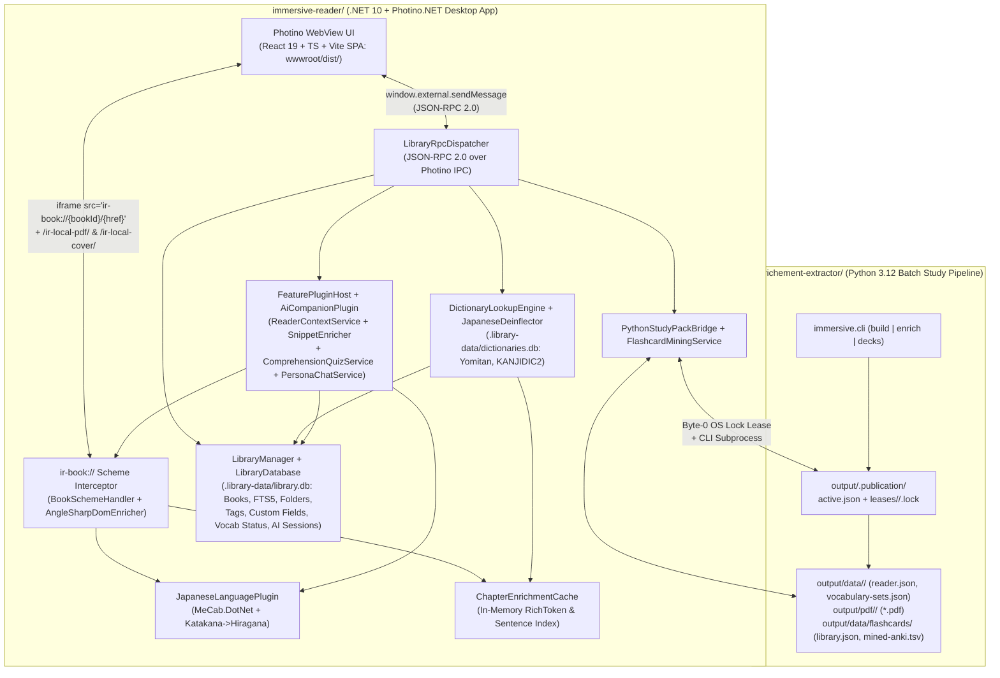

# Developer Onboarding & Architecture Guide (`immersive-reading`)

Welcome to the **Immersive Reading** repository! If you just opened this workspace and want to understand **how the pieces fit together** or **jump straight into modifying a specific subsystem**, this guide is for you.

> [!TIP]
> Looking for instructions on how to use the desktop application, manage books, or use reader shortcuts? See the **[USERGUIDE.md](USERGUIDE.md)**.

---

## 1. Quick-Find: "I Want to Work On... Where Do I Start?"

Use this table to jump directly to the files responsible for the area you want to change:

| What You Want to Work On | Primary Entry Files | Key Classes / Functions | Tests to Run |
| :--- | :--- | :--- | :--- |
| **Desktop UI (Library Grid, Reader Controls, Popover, Drawers)** | [`client/src/`](immersive-reader/src/ImmersiveReading.App/client/) (React 19 + TS + Vite)<br>[`MainWindowHost.cs`](immersive-reader/src/ImmersiveReading.App/Hosting/MainWindowHost.cs)<br>[`AppSchemeHandler.cs`](immersive-reader/src/ImmersiveReading.App/Hosting/AppSchemeHandler.cs) | `useLibraryStore`, `useReaderStore`, `usePluginStore`, `useStudyPackStore`, `useConfigStore` | `dotnet run --project immersive-reader/src/ImmersiveReading.App -- --verify-ui` |
| **JSON-RPC Bridge (Adding/Changing Frontend $\leftrightarrow$ C# APIs)** | [`LibraryRpcDispatcher.cs`](immersive-reader/src/ImmersiveReading.App/Rpc/LibraryRpcDispatcher.cs)<br>[`src/ImmersiveReading.App/Rpc/Modules/`](immersive-reader/src/ImmersiveReading.App/Rpc/Modules/)<br>[`Program.cs`](immersive-reader/src/ImmersiveReading.App/Program.cs) | [`IRpcModule`](immersive-reader/src/ImmersiveReading.App/Rpc/IRpcModule.cs), [`LibraryRpcDispatcher.DispatchJsonAsync`](immersive-reader/src/ImmersiveReading.App/Rpc/LibraryRpcDispatcher.cs) | [`Phase1LibrarySpecsTests.cs`](immersive-reader/tests/ImmersiveReading.Core.Tests/Phase1LibrarySpecsTests.cs) |
| **EPUB Library, 24k+ Scanner, Folders, Tags & Custom Fields** | [`LibraryManager.cs`](immersive-reader/src/ImmersiveReading.Library/LibraryManager.cs)<br>[`Library/Books/`](immersive-reader/src/ImmersiveReading.Library/Books/)<br>[`Library/Folders/`](immersive-reader/src/ImmersiveReading.Library/Folders/)<br>[`Library/Tags/`](immersive-reader/src/ImmersiveReading.Library/Tags/)<br>[`Library/CustomFields/`](immersive-reader/src/ImmersiveReading.Library/CustomFields/)<br>[`LibraryDatabase.cs`](immersive-reader/src/ImmersiveReading.Library/LibraryDatabase.cs)<br>[`EpubMetadataExtractor.cs`](immersive-reader/src/ImmersiveReading.Core/Epub/EpubMetadataExtractor.cs) | [`BookImportService`](immersive-reader/src/ImmersiveReading.Library/Books/BookImportService.cs), [`BookQueryService`](immersive-reader/src/ImmersiveReading.Library/Books/BookQueryService.cs), [`FolderService`](immersive-reader/src/ImmersiveReading.Library/Folders/FolderService.cs), [`TagService`](immersive-reader/src/ImmersiveReading.Library/Tags/TagService.cs), [`CustomFieldService`](immersive-reader/src/ImmersiveReading.Library/CustomFields/CustomFieldService.cs), [`MigrationRunner`](immersive-reader/src/ImmersiveReading.Core/Database/MigrationRunner.cs), `ClearLibrary` (Danger Zone) | [`Phase1LibrarySpecsTests.cs`](immersive-reader/tests/ImmersiveReading.Core.Tests/Phase1LibrarySpecsTests.cs) |
| **EPUB Chapter Rendering, `<ruby>` Furigana, Search & Bookmarks** | [`BookSchemeHandler.cs`](immersive-reader/src/ImmersiveReading.Enrichment/BookSchemeHandler.cs)<br>[`AngleSharpDomEnricher.cs`](immersive-reader/src/ImmersiveReading.Enrichment/AngleSharpDomEnricher.cs)<br>[`Enrichment/Dom/`](immersive-reader/src/ImmersiveReading.Enrichment/Dom/)<br>[`ReaderSearchBar.tsx`](immersive-reader/src/ImmersiveReading.App/client/src/components/reader/ReaderSearchBar.tsx)<br>[`BookmarksDrawer.tsx`](immersive-reader/src/ImmersiveReading.App/client/src/components/reader/BookmarksDrawer.tsx)<br>[`ir-reader-bridge.js`](immersive-reader/src/ImmersiveReading.App/wwwroot/assets/ir-reader-bridge.js) | [`BookSchemeHandler.ResolveAsync`](immersive-reader/src/ImmersiveReading.Enrichment/BookSchemeHandler.cs), [`AngleSharpDomEnricher.EnrichChapterAsync`](immersive-reader/src/ImmersiveReading.Enrichment/AngleSharpDomEnricher.cs), In-Reader Search (`Ctrl+F`), User Bookmarks | [`Phase2EnrichmentSpecsTests.cs`](immersive-reader/tests/ImmersiveReading.Enrichment.Tests/Phase2EnrichmentSpecsTests.cs) |
| **Japanese Morphological Analysis (`MeCab.DotNet`) or Adding a Language** | [`ILanguagePlugin.cs`](immersive-reader/src/ImmersiveReading.Core/Plugins/ILanguagePlugin.cs)<br>[`JapaneseLanguagePlugin.cs`](immersive-reader/src/Plugins/ImmersiveReading.Plugins.Japanese/JapaneseLanguagePlugin.cs)<br>[`IDeinflectionRuleProvider.cs`](immersive-reader/src/ImmersiveReading.Core/Plugins/IDeinflectionRuleProvider.cs) | [`ILanguagePlugin`](immersive-reader/src/ImmersiveReading.Core/Plugins/ILanguagePlugin.cs), [`JapaneseLanguagePlugin.AnalyzeParagraphsAsync`](immersive-reader/src/Plugins/ImmersiveReading.Plugins.Japanese/JapaneseLanguagePlugin.cs), [`IDeinflectionRuleProvider`](immersive-reader/src/ImmersiveReading.Core/Plugins/IDeinflectionRuleProvider.cs) | [`Phase2EnrichmentSpecsTests.cs`](immersive-reader/tests/ImmersiveReading.Enrichment.Tests/Phase2EnrichmentSpecsTests.cs) |
| **Instant Dictionary Lookup, Deinflection & Word Status (`Known`/`Learning`)** | [`DictionaryLookupEngine.cs`](immersive-reader/src/ImmersiveReading.Dictionaries/DictionaryLookupEngine.cs)<br>[`Dictionaries/Lookup/`](immersive-reader/src/ImmersiveReading.Dictionaries/Lookup/)<br>[`JapaneseDeinflector.cs`](immersive-reader/src/Plugins/ImmersiveReading.Plugins.Japanese/JapaneseDeinflector.cs)<br>[`IDictionaryImporter.cs`](immersive-reader/src/ImmersiveReading.Dictionaries/Abstractions/IDictionaryImporter.cs)<br>[`DictionaryImporterRegistry.cs`](immersive-reader/src/ImmersiveReading.Dictionaries/Abstractions/DictionaryImporterRegistry.cs)<br>[`VocabularyTracker.cs`](immersive-reader/src/ImmersiveReading.Dictionaries/VocabularyTracker.cs) | [`DictionaryLookupEngine.LookupAsync`](immersive-reader/src/ImmersiveReading.Dictionaries/DictionaryLookupEngine.cs), [`JapaneseDeinflector.Deinflect`](immersive-reader/src/Plugins/ImmersiveReading.Plugins.Japanese/JapaneseDeinflector.cs), [`IDictionaryImporter`](immersive-reader/src/ImmersiveReading.Dictionaries/Abstractions/IDictionaryImporter.cs), [`TermRanker`](immersive-reader/src/ImmersiveReading.Dictionaries/Lookup/TermRanker.cs) | [`Phase3DictionarySpecsTests.cs`](immersive-reader/tests/ImmersiveReading.Dictionaries.Tests/Phase3DictionarySpecsTests.cs) |
| **1-Click Sentence Flashcards, AnkiConnect Sync & Study Pack Bridge** | [`FlashcardMiningService.cs`](immersive-reader/src/ImmersiveReading.Library/FlashcardMiningService.cs)<br>[`AnkiConnectClient.cs`](immersive-reader/src/ImmersiveReading.Library/Flashcards/AnkiConnectClient.cs)<br>[`Library/Flashcards/`](immersive-reader/src/ImmersiveReading.Library/Flashcards/)<br>[`PythonStudyPackBridge.cs`](immersive-reader/src/ImmersiveReading.Library/PythonStudyPackBridge.cs)<br>[`Library/StudyPack/`](immersive-reader/src/ImmersiveReading.Library/StudyPack/) | [`FlashcardMiningService.MineCard`](immersive-reader/src/ImmersiveReading.Library/FlashcardMiningService.cs), [`AnkiConnectClient`](immersive-reader/src/ImmersiveReading.Library/Flashcards/AnkiConnectClient.cs), [`PythonStudyPackBridge.AcquireSnapshotLease`](immersive-reader/src/ImmersiveReading.Library/PythonStudyPackBridge.cs) | [`Phase4StudyPackSpecsTests.cs`](immersive-reader/tests/ImmersiveReading.Core.Tests/Phase4StudyPackSpecsTests.cs) |
| **Unified Plugin System (C# Host, Sandboxed SQLite WAL, Dynamic ESM & Slots)** | [`IImmersivePlugin.cs`](immersive-reader/src/ImmersiveReading.Core/Plugins/IImmersivePlugin.cs)<br>[`PluginHostManager.cs`](immersive-reader/src/ImmersiveReading.App/Plugins/PluginHostManager.cs)<br>[`PluginDatabaseContext.cs`](immersive-reader/src/ImmersiveReading.App/Plugins/PluginDatabaseContext.cs)<br>[`PluginConfigContext.cs`](immersive-reader/src/ImmersiveReading.App/Plugins/PluginConfigContext.cs)<br>[`PluginEventBusHub.cs`](immersive-reader/src/ImmersiveReading.App/Plugins/PluginEventBusHub.cs)<br>[`src/sdk/`](immersive-reader/src/ImmersiveReading.App/client/src/sdk/)<br>[`usePluginStore.ts`](immersive-reader/src/ImmersiveReading.App/client/src/stores/usePluginStore.ts)<br>[`PluginSettingsTab.tsx`](immersive-reader/src/ImmersiveReading.App/client/src/components/settings/PluginSettingsTab.tsx) | [`IImmersivePlugin`](immersive-reader/src/ImmersiveReading.Core/Plugins/IImmersivePlugin.cs), [`PluginHostManager`](immersive-reader/src/ImmersiveReading.App/Plugins/PluginHostManager.cs), [`IPluginHostContext`](immersive-reader/src/ImmersiveReading.Core/Plugins/IPluginHostContext.cs), `usePluginStore`, `@ir/sdk` | [`UnifiedPluginSystemTests.cs`](immersive-reader/tests/ImmersiveReading.App.Tests/UnifiedPluginSystemTests.cs) |
| **AI Comprehension Quizzes, $n+1$ Persona Chat & Companion Plugin** | [`AiCompanionPlugin.cs`](immersive-reader/src/Plugins/ImmersiveReading.Plugins.AiCompanion/AiCompanionPlugin.cs)<br>[`ComprehensionQuizService.cs`](immersive-reader/src/Plugins/ImmersiveReading.Plugins.AiCompanion/ComprehensionQuizService.cs)<br>[`PersonaChatService.cs`](immersive-reader/src/Plugins/ImmersiveReading.Plugins.AiCompanion/PersonaChatService.cs)<br>[`ILlmProviderFactory.cs`](immersive-reader/src/ImmersiveReading.Core/Extensions/LlmContracts.cs)<br>[`LlmRequestBuilder.cs`](immersive-reader/src/ImmersiveReading.Core/Extensions/LlmRequestBuilder.cs)<br>[`ReaderContextService.cs`](immersive-reader/src/ImmersiveReading.Enrichment/ReaderContextService.cs)<br>[`SnippetEnricher.cs`](immersive-reader/src/ImmersiveReading.Enrichment/SnippetEnricher.cs) | [`AiCompanionPlugin`](immersive-reader/src/Plugins/ImmersiveReading.Plugins.AiCompanion/AiCompanionPlugin.cs), [`ComprehensionQuizService`](immersive-reader/src/Plugins/ImmersiveReading.Plugins.AiCompanion/ComprehensionQuizService.cs), [`PersonaChatService`](immersive-reader/src/Plugins/ImmersiveReading.Plugins.AiCompanion/PersonaChatService.cs), [`LlmRequestBuilder`](immersive-reader/src/ImmersiveReading.Core/Extensions/LlmRequestBuilder.cs), [`ReaderContextService.GetJustReadPassageAsync`](immersive-reader/src/ImmersiveReading.Enrichment/ReaderContextService.cs) | [`Phase5AiCompanionSpecsTests.cs`](immersive-reader/tests/ImmersiveReading.Enrichment.Tests/Phase5AiCompanionSpecsTests.cs) |
| **Global Configuration (Directories, Colors, Typography, LLM, Dictionaries)** | [`ConfigurationManager.cs`](immersive-reader/src/ImmersiveReading.Library/ConfigurationManager.cs)<br>[`AppConfig.cs`](immersive-reader/src/ImmersiveReading.Core/Config/AppConfig.cs)<br>[`LibraryDatabase.cs`](immersive-reader/src/ImmersiveReading.Library/LibraryDatabase.cs)<br>[`LibraryRpcDispatcher.cs`](immersive-reader/src/ImmersiveReading.App/Rpc/LibraryRpcDispatcher.cs)<br>[`index.html`](immersive-reader/src/ImmersiveReading.App/wwwroot/index.html) | `config.*` RPC methods, `app_settings` table, dynamic CSS variables | [`GlobalConfigurationSpecsTests.cs`](immersive-reader/tests/ImmersiveReading.Core.Tests/GlobalConfigurationSpecsTests.cs) |
| **Offline Python Study Pack & Printable A4 PDF Pipeline** | [`enrichment.py`](enrichement-extractor/immersive/enrichment.py)<br>[`build.py`](enrichement-extractor/immersive/build.py)<br>[`study_data.py`](enrichement-extractor/immersive/study_data.py)<br>[`kanji_pdf.py`](enrichement-extractor/immersive/kanji_pdf.py)<br>[`publication.py`](enrichement-extractor/immersive/publication.py) | [`enrich_book()`](enrichement-extractor/immersive/enrichment.py#L22-L70), [`build_data()`](enrichement-extractor/immersive/build.py#L79-L351), [`prepare_study_data()`](enrichement-extractor/immersive/study_data.py#L51-L77) | `cd enrichement-extractor && .venv\Scripts\python.exe -m unittest discover -s tests -v` |
| **Pluggable Python Pipeline Stages (Language-Agnostic DAG Runner)** | [`PythonStageContracts.cs`](immersive-reader/src/ImmersiveReading.Core/Plugins/PythonStageContracts.cs)<br>[`IPythonStageRegistryProvider.cs`](immersive-reader/src/ImmersiveReading.Core/Plugins/IPythonStageRegistryProvider.cs)<br>[`stage.py`](enrichement-extractor/immersive/sdk/stage.py)<br>[`pipeline_runner.py`](enrichement-extractor/immersive/pipeline_runner.py)<br>[`ja_stages.py`](immersive-reader/src/Plugins/ImmersiveReading.Plugins.Japanese/python/ja_stages.py) | `PythonStageDescriptor`, `PipelineStage`, `PipelineContext`, `run_pipeline_from_manifest` | [`PluggablePythonPipelineTests.cs`](immersive-reader/tests/ImmersiveReading.App.Tests/PluggablePythonPipelineTests.cs) |
| **Part-of-Speech Highlighter Plugin (Visual Grammar & DOM Enrichment)** | [`PosHighlighterPlugin.cs`](immersive-reader/src/Plugins/ImmersiveReading.Plugins.PosHighlighter/PosHighlighterPlugin.cs)<br>[`PosHighlighterModule.cs`](immersive-reader/src/Plugins/ImmersiveReading.Plugins.PosHighlighter/PosHighlighterModule.cs)<br>[`PosClassifier.cs`](immersive-reader/src/Plugins/ImmersiveReading.Plugins.PosHighlighter/PosClassifier.cs)<br>[`PosDomEnrichmentStage.cs`](immersive-reader/src/Plugins/ImmersiveReading.Plugins.PosHighlighter/PosDomEnrichmentStage.cs)<br>[`IDomEnrichmentStage.cs`](immersive-reader/src/ImmersiveReading.Core/Extensions/IReaderServices.cs) | `PosClassifier`, `PosDomEnrichmentStage`, `PosHighlighterPlugin`, `PosHighlighterModule`, `IDomEnrichmentStage` | [`PosHighlighterTests.cs`](immersive-reader/tests/ImmersiveReading.App.Tests/PosHighlighterTests.cs) |

---

## 2. High-Level System Architecture: How the Two Halves Connect

The workspace is split into two top-level directories that cooperate seamlessly through deterministic IDs (`book-<16 hex>`) and atomic file/lock contracts:

1. **[`immersive-reader/`](immersive-reader) (.NET 10 + Photino.NET Desktop Application)**
   - **Purpose**: High-scale EPUB library management (24,000+ books), real-time pre-render EPUB enrichment (`AngleSharp` + `MeCab.DotNet`), sub-5ms SQLite dictionary popovers, flashcard mining, and the AI Comprehension & $n+1$ Persona Chat companion.
   - **Zero pre-processing required to read**: You can drop any raw `.epub` into the library and open it immediately; chapters are enriched in-memory on the fly in ~15–40 ms when navigated to.
2. **[`enrichement-extractor/`](enrichement-extractor) (Python 3.12 Batch Study-Pack & Printable PDF Generator)**
   - **Purpose**: Offline, whole-book linguistic analysis (`SudachiPy`), 20-word ordered learning sets (`vocabulary-sets.json`), kanji context cards (`kanji-context.json`), companion HTML sites, and printable A4 study sheets (`kanji-master.pdf`, `vocabulary-master.pdf`, `grammar-master.pdf`, `chapter-XX-*.pdf`).



### How `.NET` and `Python` Share Identity & Data
- **Shared Deterministic Book ID (`book-<16 hex>`)**:
  Both [`BookIdentity.ComputeBookId`](immersive-reader/src/ImmersiveReading.Core/Epub/BookIdentity.cs) in C# and [`uid("book", sha256(epub_bytes).hexdigest())`](enrichement-extractor/immersive/build.py#L96) in Python compute the exact same ID: `"book-" + sha256(raw_epub_bytes)[0..16].ToLowerInvariant()`.
- **Shared Publication & Lease Protocol (`output/.publication/`)**:
  When Python publishes a study pack, it writes an immutable snapshot to `enrichement-extractor/output/.publication/releases/<32-hex-generation>/` and updates `output/.publication/active.json`.
  When the .NET reader opens a book's Study Pack drawer, [`PythonStudyPackBridge.AcquireSnapshotLease`](immersive-reader/src/ImmersiveReading.Library/PythonStudyPackBridge.cs#L152-L173) creates `.publication/leases/<generation>/<uuid>.lock` and locks byte `0` (`FileStream.Lock(0, 1)`). Python's garbage collector ([`retention.py`](enrichement-extractor/immersive/retention.py#L66-L78)) probes byte `0` before deleting old releases, guaranteeing zero race conditions while PDFs or JSON sets are open in the reader.

---

## 3. Solution Layout (`immersive-reader/`)

Inside [`immersive-reader/ImmersiveReading.sln`](immersive-reader/ImmersiveReading.sln), dependencies flow strictly downward (no circular references). Notably, `Enrichment`, `Dictionaries`, and `Plugins` depend **only on Core**:

```text
immersive-reader/
├── ImmersiveReading.sln
├── .library-data/                                    # Runtime SQLite databases & extracted covers
│   ├── library.db                                    # User library, hierarchy, vocab states, AI sessions
│   ├── dictionaries.db                               # Imported Yomitan & KANJIDIC2 dictionaries
│   └── covers/                                       # Extracted EPUB cover thumbnails (<book-id>.jpg)
├── src/
│   ├── ImmersiveReading.Core/                        # Zero-dependency contracts & domain records
│   │   ├── Database/                                 # IDbConnectionFactory, IDbMigration, MigrationRunner
│   │   ├── Library/                                  # Modular BookModels, OrganizationModels, CustomFieldModels, etc.
│   │   ├── Books/ & Study/                           # IBookCatalog, IStudyPackCatalog, IVocabularyService
│   │   ├── Epub/                                     # EpubMetadataExtractor, BookIdentity, EpubArchiveReader
│   │   ├── Plugins/                                  # ILanguagePlugin, IDeinflectionRuleProvider, RichToken, EnrichedParagraph
│   │   └── Extensions/                               # IFeaturePlugin, IPluginModule, ILlmProvider, ILlmProviderFactory, LlmRequestBuilder
│   ├── ImmersiveReading.Library/                     # SQLite library, EPUB scanner, Python bridge, mining
│   │   ├── LibraryDatabase.cs                        # IDbConnectionFactory implementation + WAL mode
│   │   ├── Schema/LibraryMigrations.cs               # Versioned migrations (v1 Core Tables, v2 Legacy AI Tables)
│   │   ├── LibraryManager.cs                         # Lean facade coordinator delegating to sub-services (<150 lines)
│   │   ├── Books/                                    # BookQueryService, BookMetadataService, BookImportService, BookListSqlBuilder
│   │   ├── Folders/ & Tags/ & CustomFields/          # FolderService, TagService, CustomFieldService
│   │   ├── Jiten/                                    # JitenMoeService, JitenModels, JitenResponseParser, IJitenApiKeyProvider
│   │   ├── StudyPack/                                # PythonStudyPackBridge, SnapshotLeaseManager, PublicationReader, PythonBuildRunner
│   │   └── Flashcards/                               # FlashcardMiningService, FlashcardLibraryStore, AnkiTsvWriter
│   ├── ImmersiveReading.Enrichment/                  # Real-time AngleSharp XHTML enrichment & context slicing (Depends ONLY on Core)
│   │   ├── AngleSharpDomEnricher.cs                  # Lean orchestrator (<130 lines) delegating to Dom/ components
│   │   ├── Dom/                                      # TokenDomApplier, BlockDiscovery, PolyglotXhtmlMarkupFormatter, EpubUrlRewriter, ReaderHeadInjector
│   │   ├── BookSchemeHandler.cs                      # Resolves ir-book://{bookId}/{path} requests
│   │   ├── ChapterEnrichmentCache.cs                 # Thread-safe bounded LRU cache of enriched chapters & snippets
│   │   ├── ReaderContextService.cs                   # Zero-spoiler text/token slicer up to current progress
│   │   └── SnippetEnricher.cs                        # Enriches AI quiz/chat HTML snippets for 1-click lookup
│   ├── ImmersiveReading.Dictionaries/                # Sub-5ms dictionary lookup & deinflection (Depends ONLY on Core)
│   │   ├── Abstractions/                             # IDictionaryImporter strategy & DictionaryImporterRegistry
│   │   ├── DictionaryDatabase.cs                     # dictionaries.db schema with MigrationRunner
│   │   ├── Schema/DictionaryMigrations.cs            # Versioned dictionary table migrations (v1 Dictionaries & Kanji)
│   │   ├── YomitanSqliteImporter.cs                  # Imports Yomitan format-3 .zip dictionaries
│   │   ├── KanjidicImporter.cs                       # Imports kanjidic2.xml.gz, ka_data.csv, KanjiVG SVGs
│   │   ├── DictionaryLookupEngine.cs                 # Lean coordinator (<130 lines) delegating to Lookup/ components
│   │   ├── Lookup/                                   # TermRanker, LookupCandidateGenerator, SentenceExtractor, PitchFrequencyParser, TermRepository
│   │   └── VocabularyTracker.cs                      # Reads/writes user_vocabulary status
│   ├── Plugins/
│   │   ├── ImmersiveReading.Plugins.Japanese/        # MeCab.DotNet tokenizer, StandardJapaneseDeinflectionRules, JapaneseDeinflector
│   │   └── ImmersiveReading.Plugins.AiCompanion/     # AiCompanionModule (DI registration), DefaultLlmProviderFactory, Prompts/
│   └── ImmersiveReading.App/                         # Photino.NET Desktop Host, Local Asset Server & Web UI
│       ├── Program.cs                                # Lean composition root (~40 lines)
│       ├── Composition/                              # AppPaths, AppServices (Microsoft.Extensions.DependencyInjection), PluginCatalog
│       ├── Hosting/                                  # MainWindowHost, AppSchemeHandler
│       ├── Cli/                                      # SmokeTest, ReaderVerification
│       ├── Rpc/                                      # LibraryRpcDispatcher router & IRpcModule
│       │   └── Modules/                              # BootstrapRpcModule, LibraryRpcModule, JitenRpcModule, ReaderRpcModule, DictionaryRpcModule, StudyPackRpcModule, ConfigRpcModule, ExtensionsRpcModule
│       ├── client/                                   # Modern React 19 + TypeScript + Vite SPA
│       │   ├── src/
│       │   │   ├── components/                       # Header, Sidebar, LibraryGrid, BookCard, ReaderView, DictionaryPopover, Drawers, Modals
│       │   │   ├── stores/                           # Zustand stores: useLibraryStore, useReaderStore, usePluginStore, useStudyPackStore, useConfigStore
│       │   │   ├── services/                         # rpc.ts (Photino IPC bridge), selfTestRunner.ts
│       │   │   └── types/api.ts                      # Strongly typed TypeScript contracts matching C# DTOs
│       │   ├── public/assets/                        # Assets copied to wwwroot/dist/assets
│       │   └── vite.config.ts                        # Outputs to wwwroot/dist/ with relative base path ('./')
│       └── wwwroot/
│           ├── dist/                                 # Production Vite bundle loaded by Photino MainWindowHost (index.html, assets/index-*.js, index-*.css)
│           └── assets/                               # Standalone scripts: ir-reader-bridge.js, ir-reader-injected.css (injected into chapter iframes)
│   └── tests/
│       ├── ImmersiveReading.Core.Tests/              # Phase 1 (Library, Books, SQL Builder) & Phase 4 (Study Pack/Mining) tests
│       ├── ImmersiveReading.Enrichment.Tests/        # Phase 2 (AngleSharp/MeCab, LRU Cache) & Phase 5 (AI/n+1) tests
│       ├── ImmersiveReading.Dictionaries.Tests/      # Phase 3 (Deinflection, Yomitan, Lookup) tests
│       └── ImmersiveReading.App.Tests/               # RPC dispatching, local asset server, and integration tests
```

---

## 4. Five Core End-to-End Flows (How Things Are Connected)

Understanding these 5 flows will explain 95% of what happens at runtime.

### Flow 1: Frontend Button Click $\rightarrow$ C# Backend (`JSON-RPC 2.0`)
1. **Frontend ([`client/src/services/rpc.ts`](immersive-reader/src/ImmersiveReading.App/client/src/services/rpc.ts))**:
   Any UI action calls `await rpc.call("domain.methodName", { ...params })`.
   - Under the hood, `rpc.call` generates a request ID (`req-1`, `req-2`, ...), stores a Promise in `pendingCalls`, and calls `window.external.sendMessage(JSON.stringify({ id, method, params }))`.
2. **Photino Bridge ([`MainWindowHost.cs`](immersive-reader/src/ImmersiveReading.App/Hosting/MainWindowHost.cs))**:
   `window.RegisterWebMessageReceivedHandler` receives the JSON string on a background task and passes it to [`LibraryRpcDispatcher.DispatchJsonAsync`](immersive-reader/src/ImmersiveReading.App/Rpc/LibraryRpcDispatcher.cs).
3. **Router ([`LibraryRpcDispatcher.cs`](immersive-reader/src/ImmersiveReading.App/Rpc/LibraryRpcDispatcher.cs))**:
   - Built-in routes are organized into modular [`IRpcModule`](immersive-reader/src/ImmersiveReading.App/Rpc/IRpcModule.cs) implementations in [`src/ImmersiveReading.App/Rpc/Modules/`](immersive-reader/src/ImmersiveReading.App/Rpc/Modules/):
     - `BootstrapRpcModule`: `library.getBootstrapState`, `app.shutdown`
     - `LibraryRpcModule`: `library.listBooks`, `library.getBookDetail`, `library.scanDirectory`, `library.importEpub`, `library.mineFlashcard`
     - `JitenRpcModule`: `jiten.searchFranchises`, `jiten.syncBook`
     - `ReaderRpcModule`: `reader.openBook`, `reader.getChapterContent`, `reader.saveProgress`, `lookup.query`, `vocab.setStatus`
     - `DictionaryRpcModule`: `dictionaries.list`, `dictionaries.import`
     - `StudyPackRpcModule`: `studypack.getOverview`, `studypack.build`
     - `ConfigRpcModule`: `config.getAll`, `config.saveAll`, `config.testLlmEndpoint`
     - `ExtensionsRpcModule`: `extensions.list`
   - Plugin routes (such as `ext.aiCompanion.*`) fall through to the fallback router where [`_featurePluginHost.TryHandleRpcAsync(method, p, ct)`](immersive-reader/src/ImmersiveReading.App/Rpc/LibraryRpcDispatcher.cs) dispatches them to the registered [`IFeaturePlugin`](immersive-reader/src/ImmersiveReading.Core/Extensions/IFeaturePlugin.cs).
4. **Response**:
   `DispatchJsonAsync` serializes `{ id, result, error }` and calls `window.SendWebMessage(responseJson)`, resolving the Promise in `rpc.call`.

---

### Flow 2: Opening a Book & Pre-Render Chapter Enrichment (`ir-book://`)
When a user clicks **Read** on a book card:
1. **Session Load ([`useReaderStore.ts`](immersive-reader/src/ImmersiveReading.App/client/src/stores/useReaderStore.ts))**:
   Calls `rpc.call("reader.openBook", { bookId })`, which returns the book's spine chapters, TOC, saved `reading_progress` (`chapterIndex`, `tokenId`, `writingMode`), and the initial chapter's pre-rendered HTML (`initialChapterHtml`).
2. **Custom Scheme Interception ([`Program.cs`](immersive-reader/src/ImmersiveReading.App/Program.cs) $\rightarrow$ [`BookSchemeHandler.cs`](immersive-reader/src/ImmersiveReading.Enrichment/BookSchemeHandler.cs))**:
   - The reader sets `<iframe id="reader-frame" srcDoc={chapterHtml}>` (with direct `ir-book://` assets resolution for relative images/fonts).
   - If the path is an image, font, or CSS file inside the EPUB ZIP, `BookSchemeHandler` streams the raw bytes directly from the `.epub` archive with the appropriate MIME type.
   - If the path is an `.xhtml` / `.html` spine document, `BookSchemeHandler` passes the raw XHTML to [`AngleSharpDomEnricher.EnrichChapterAsync`](immersive-reader/src/ImmersiveReading.Enrichment/AngleSharpDomEnricher.cs).
3. **Ruby-Aware DOM Walking & MeCab Tokenization ([`AngleSharpDomEnricher.cs`](immersive-reader/src/ImmersiveReading.Enrichment/AngleSharpDomEnricher.cs))**:
   - Parses the XHTML with `AngleSharp.Xml.Parser.XmlParser`.
   - Walks block paragraphs (`p`, `h1`–`h6`, `li`, `blockquote`, or `div` with direct text).
   - Extracts existing author `<ruby><rb>ベース</rb><rt>ふりがな</rt></ruby>` annotations **before** stripping `<rt>`/`<rp>` so ruby text never pollutes the base string sent to the tokenizer.
   - Passes the clean paragraph texts and author ruby spans to [`JapaneseLanguagePlugin.AnalyzeParagraphsAsync`](immersive-reader/src/Plugins/ImmersiveReading.Plugins.Japanese/JapaneseLanguagePlugin.cs), which runs `MeCab.DotNet`, converts UniDic/IPADIC katakana readings to hiragana, splits okurigana stems (`align`), and preserves author `<ruby>` readings (`RubySource.EpubAuthor`) over tokenizer guesses (`RubySource.Tokenizer`).
   - Replaces text nodes in the AngleSharp DOM with interactive spans:
     ```html
     <span class="ir-tok ir-pos-noun" data-tid="42" data-sid="7" data-pid="3" data-lemma="魔法" data-read="まほう" data-pos="noun" data-status="learning">
       <ruby class="ir-ruby" data-ruby-src="epub"><rb>魔</rb><rt>ま</rt><rb>法</rb><rt>ほう</rt></ruby>
     </span>
     ```
   - Injects `ir-app://assets/ir-reader-injected.css` and `ir-app://assets/ir-reader-bridge.js` into `<head>`/`<body>` and caches the `EnrichedChapterResult` (including the `IReadOnlyDictionary<int, RichToken>` map) inside [`ChapterEnrichmentCache`](immersive-reader/src/ImmersiveReading.Enrichment/ChapterEnrichmentCache.cs).

---

### Flow 3: Clicking a Word $\rightarrow$ Sub-5ms Dictionary Popover & Sentence Mining
1. **Click Inside Chapter ([`ChapterIframe.tsx`](immersive-reader/src/ImmersiveReading.App/client/src/components/reader/ChapterIframe.tsx))**:
   - Clicking any `.ir-tok` span inside the iframe triggers `ir-reader-bridge.js`, which notifies the React parent window via `window.parent.postMessage({ type: "ir-token-click", tokenId, clientRect })`.
2. **Lookup RPC (`lookup.query`)**:
   - [`useReaderStore.ts`](immersive-reader/src/ImmersiveReading.App/client/src/stores/useReaderStore.ts) calls `rpc.call("lookup.query", { bookId, chapterHref, tokenId })`.
   - [`DictionaryLookupEngine.LookupAsync`](immersive-reader/src/ImmersiveReading.Dictionaries/DictionaryLookupEngine.cs) fetches the cached chapter from `ChapterEnrichmentCache`, locates the clicked `RichToken` and its containing sentence, and extracts up to 16 characters of surface text starting at the clicked token's start offset.
   - Generates candidate substrings (longest first) and runs [`JapaneseDeinflector.Deinflect`](immersive-reader/src/Plugins/ImmersiveReading.Plugins.Japanese/JapaneseDeinflector.cs) (e.g., `食べさせられなかった` $\rightarrow$ `食べる`).
   - Queries `dictionaries.db` (`terms` table by `expression` and `reading_hira`) and ranks matches by:
     1. Longest surface substring match
     2. Exact match with EPUB author `<ruby>` reading (`RubySource.EpubAuthor`)
     3. Exact match with `MeCab` lemma & reading
     4. Valid grammar part-of-speech chain from deinflection
     5. Dictionary priority & frequency rank
   - Also queries `kanji_characters` in `dictionaries.db` for every kanji character in the matched headword (meanings, on/kun readings, JLPT, stroke count, KanjiVG SVG).
3. **Mining a Sentence Flashcard (`flashcards.mine`)**:
   - Clicking **+ Mine Card** in [`DictionaryPopover.tsx`](immersive-reader/src/ImmersiveReading.App/client/src/components/reader/DictionaryPopover.tsx) calls `rpc.call("flashcards.mine", { ... })` $\rightarrow$ [`FlashcardMiningService.MineCard`](immersive-reader/src/ImmersiveReading.Library/FlashcardMiningService.cs).
   - Writes atomically to `enrichement-extractor/output/data/flashcards/library.json` and `mined-anki.tsv` with `<ruby>` furigana and `<mark>` around the target word. **Story sentences are never translated into English.**

---

### Flow 4: Study Pack Bridge & Printable PDFs (`studyPack.*`)
1. When the user clicks **Study** in the Reader topbar, [`useStudyPackStore.ts`](immersive-reader/src/ImmersiveReading.App/client/src/stores/useStudyPackStore.ts) calls `rpc.call("studypack.getOverview", { bookId })`.
2. [`PythonStudyPackBridge`](immersive-reader/src/ImmersiveReading.Library/PythonStudyPackBridge.cs) checks `enrichement-extractor/output/.publication/active.json`, acquires an OS byte-range lease (`AcquireSnapshotLease`), and inspects `output/pdf/<book-id>/` and `output/data/<book-id>/vocabulary-sets.json`.
3. Master and chapter PDFs are served to the frontend via the local asset server in [`Program.cs`](immersive-reader/src/ImmersiveReading.App/Program.cs#L244-L320) (`/ir-local-pdf/<book-id>/<filename>.pdf`), so they open directly inside the embedded PDF viewer modal or external viewer.
4. If a book does not yet have a prebuilt study pack, clicking **⚡ Build Study Pack** invokes `enrichement-extractor\.venv\Scripts\python.exe -m immersive.cli build|enrich` asynchronously.

---

### Flow 5: AI Companion Plugin (Zero-Spoiler Quiz & $n+1$ Persona Chat)
1. **Extension Bus Registration**:
   At startup in [`Program.cs`](immersive-reader/src/ImmersiveReading.App/Program.cs), modules listed in [`PluginCatalog.cs`](immersive-reader/src/ImmersiveReading.App/Composition/PluginCatalog.cs) are resolved, and [`AiCompanionPlugin`](immersive-reader/src/Plugins/ImmersiveReading.Plugins.AiCompanion/AiCompanionPlugin.cs) is registered with [`FeaturePluginHost`](immersive-reader/src/ImmersiveReading.Core/Extensions/FeaturePluginContracts.cs).
2. **Zero-Spoiler Context Slicing ([`ReaderContextService.cs`](immersive-reader/src/ImmersiveReading.Enrichment/ReaderContextService.cs))**:
   - Before generating a quiz or persona reply, `ReaderContextService` fetches the user's current `(CurrentChapterIndex, CurrentTokenOffset)` and filters chapters/sentences so **only tokens with `ChapterIndex < CurrentChapterIndex` or `(ChapterIndex == CurrentChapterIndex && TokenId <= CurrentTokenOffset)`** are included. Unread text in the current chapter or later chapters is physically excluded from the slice.
3. **Progressive Comprehension Quiz ([`ComprehensionQuizService.cs`](immersive-reader/src/Plugins/ImmersiveReading.Plugins.AiCompanion/ComprehensionQuizService.cs))**:
   - Starts at `QuizStage.MultipleChoice` (Stage 1).
   - Tracks answers in `comprehension_questions` (`library.db`). When rolling accuracy over the last 5 questions reaches $\ge 80\%$, automatically promotes the user to `GuidedShortAnswer` (Stage 2) and then `FreeForm` (Stage 3).
4. **$n+1$ Vocabulary-Constrained Persona Chat ([`PersonaChatService.cs`](immersive-reader/src/Plugins/ImmersiveReading.Plugins.AiCompanion/PersonaChatService.cs))**:
   - Queries [`VocabularyBudgetService.GetSnapshotAsync`](immersive-reader/src/Plugins/ImmersiveReading.Plugins.AiCompanion/VocabularyBudgetService.cs) for the user's `Known` lemmas (`N`) and `Learning` / next-20-set target words (`+1`).
   - Every sentence generated by the persona is tokenized by `JapaneseLanguagePlugin` (`MeCab.DotNet`) and checked by [`PersonaChatService.ValidateSentenceComplianceAsync`](immersive-reader/src/Plugins/ImmersiveReading.Plugins.AiCompanion/PersonaChatService.cs#L198-L250) to guarantee `unknownCount <= maxUnknownWordsPerSentence` (at most one $+1$ word per sentence).
5. **Interactive AI Snippets ([`SnippetEnricher.cs`](immersive-reader/src/ImmersiveReading.Enrichment/SnippetEnricher.cs))**:
   - Every Japanese question, option, model answer, and chat bubble is enriched via `SnippetEnricher.EnrichHtmlSnippetAsync`, which stores a synthetic chapter `__snippet__/snip-XXXXX.xhtml` in `ChapterEnrichmentCache`. Clicking any word inside the AI drawer opens the exact same Dictionary Popover as the EPUB reader!

---

## 5. Step-by-Step Recipes for Common Development Tasks

### Recipe A: Adding a New RPC Endpoint & UI Button in the Desktop App
1. **Backend Method**: Add your domain logic to the relevant service (e.g., [`LibraryManager.cs`](immersive-reader/src/ImmersiveReading.Library/LibraryManager.cs) or a plugin).
2. **Expose via JSON-RPC**:
   - For core features: Register a handler in the appropriate [`IRpcModule`](immersive-reader/src/ImmersiveReading.App/Rpc/IRpcModule.cs) in [`src/ImmersiveReading.App/Rpc/Modules/`](immersive-reader/src/ImmersiveReading.App/Rpc/Modules/) (or create a new module implementing `IRpcModule`).
   - For plugin features: Handle the method inside your [`IFeaturePlugin.HandleRpcAsync`](immersive-reader/src/Plugins/ImmersiveReading.Plugins.AiCompanion/AiCompanionPlugin.cs) implementation.
3. **Call from Frontend**:
   In your React component or Zustand store:
   ```typescript
   import { rpc } from '../services/rpc';
   const data = await rpc.call<MyResponseType>("myDomain.myAction", { bookId: currentBookId });
   ```
   *(Run `npm run dev` in `client/` for instant HMR during development, or `npm run build` to compile production assets to `wwwroot/dist/`)*

### Recipe B: Adding a New Table or Column via `MigrationRunner`
1. Define a new `IDbMigration` implementation (e.g. in [`LibraryMigrations.cs`](immersive-reader/src/ImmersiveReading.Library/Schema/LibraryMigrations.cs) for `library.db` or [`DictionaryMigrations.cs`](immersive-reader/src/ImmersiveReading.Dictionaries/Schema/DictionaryMigrations.cs) for `dictionaries.db`).
2. Specify `Module` (e.g. `"core"`), `Version` (e.g. `3`), and `Description`. Implement `Up(DbConnection conn, DbTransaction? tx)`.
3. Register your migration in the database's `MigrationRunner.RunMigrations(...)` call.
4. Add strongly-typed query/command methods on the appropriate sub-service (e.g. `BookQueryService`, `TagService`, etc.) using `using var conn = _db.CreateConnection();`.
5. Write an xUnit test in [`immersive-reader/tests/`](immersive-reader/tests) using a temporary directory (`Path.Combine(Path.GetTempPath(), ...)`).

### Recipe C: Creating a New `IFeaturePlugin`
1. Create a class implementing [`IFeaturePlugin`](immersive-reader/src/ImmersiveReading.Core/Extensions/FeaturePluginContracts.cs#L15-L21) (see [`AiCompanionPlugin.cs`](immersive-reader/src/Plugins/ImmersiveReading.Plugins.AiCompanion/AiCompanionPlugin.cs) as a template).
2. In `InitializeAsync(IFeaturePluginContext context, CancellationToken ct)`, you automatically receive:
   - `context.ReaderContext` ([`IReaderContextService`](immersive-reader/src/ImmersiveReading.Core/Extensions/FeaturePluginContracts.cs#L37-L44)) for zero-spoiler text slicing.
   - `context.VocabularyBudget` ([`IVocabularyBudgetService`](immersive-reader/src/ImmersiveReading.Core/Extensions/FeaturePluginContracts.cs#L53-L57)) for querying the user's `Known` and `Learning` vocabulary.
   - `context.SnippetEnricher` ([`ISnippetEnricher`](immersive-reader/src/ImmersiveReading.Core/Extensions/FeaturePluginContracts.cs#L46-L51)) for turning plain Japanese strings into interactive `<ruby>` + `.ir-tok` HTML.
3. Register your module in [`PluginCatalog.cs`](immersive-reader/src/ImmersiveReading.App/Composition/PluginCatalog.cs) implementing [`IPluginModule`](immersive-reader/src/ImmersiveReading.Core/Extensions/IPluginModule.cs).

### Recipe D: Modifying Offline Python Enrichment or PDF Layout (`enrichement-extractor/`)
1. Consult [`LLM-WIKI.md`](LLM-WIKI.md) and the modular pages in [`wiki/`](wiki/index.md):
   - Core token/vocabulary matching: [`immersive/build.py`](enrichement-extractor/immersive/build.py) and [`immersive/matching.py`](enrichement-extractor/immersive/matching.py).
   - Furigana alignment: [`immersive/furigana.py`](enrichement-extractor/immersive/furigana.py).
   - Study sets of 20 & kanji context: [`immersive/study_data.py`](enrichement-extractor/immersive/study_data.py) and [`immersive/context.py`](enrichement-extractor/immersive/context.py).
   - Printable A4 PDFs: [`immersive/kanji_pdf.py`](enrichement-extractor/immersive/kanji_pdf.py), [`immersive/master_pdf.py`](enrichement-extractor/immersive/master_pdf.py), and [`immersive/pdf_elements.py`](enrichement-extractor/immersive/pdf_elements.py).
2. If you change `reader.json` structure, update [`immersive/reader.schema.json`](enrichement-extractor/immersive/reader.schema.json), [`immersive/validation.py`](enrichement-extractor/immersive/validation.py), and `READER_FILES` in [`immersive/cache.py`](enrichement-extractor/immersive/cache.py#L24-L26).

---

## 6. Running, Debugging & Verifying Everything

### Run the Desktop Application Interactively
```powershell
cd k:\immersive-reading\immersive-reader
dotnet run --project src\ImmersiveReading.App
```

### Run Automated End-to-End Self-Tests (Headless & Photino UI)
[`Program.cs`](immersive-reader/src/ImmersiveReading.App/Program.cs) includes built-in verification modes that test the entire stack (library bootstrap, `ir-book://` DOM enrichment, dictionary lookup, study-pack bridge, flashcard mining, and AI comprehension quiz) and exit with code `0`:
```powershell
cd k:\immersive-reading\immersive-reader

# 1. Fast CLI smoke test (verifies JSON-RPC bootstrap state)
dotnet run --project src\ImmersiveReading.App -- --smoke-test

# 2. Full backend reader verification (enrichment, lookup, study pack lease, flashcards, AI)
dotnet run --project src\ImmersiveReading.App -- --verify-reader

# 3. Real Photino WebView UI self-test (opens actual window, renders book in iframe, clicks token, opens popover, runs study pack & AI quiz)
dotnet run --project src\ImmersiveReading.App -- --verify-ui
```

### Run Unit & Specification Test Suites
```powershell
# Run all 167 .NET 10 xUnit tests (Core, Enrichment, Dictionaries, App Specs)
cd k:\immersive-reading\immersive-reader
dotnet test ImmersiveReading.sln

# Run all 134 Python unittest tests
cd k:\immersive-reading\enrichement-extractor
.venv\Scripts\python.exe -m unittest discover -s tests -v
```

### Package Standalone Releases (.ZIP / .tar.gz)
```powershell
# Windows x64 (PowerShell):
.\scripts\package_windows.ps1

# macOS Apple Silicon (ARM64 / bash):
./scripts/package_macos.sh
```
Builds a 100% self-contained single-file release (into `dist/ImmersiveReading-win-x64.zip` or `dist/ImmersiveReading-osx-arm64.tar.gz`) containing Photino (native WebView2 on Windows, native WKWebView on macOS), SQLite, MeCab dictionaries, and precompiled frontend assets. The GitHub Actions release workflow automatically compiles and packages `win-x64`, `linux-x64`, and `osx-arm64` on every release trigger.

---

## 7. Non-Negotiable Rules to Keep in Mind

Before submitting any change, verify that your code respects the project invariants defined in [`AGENTS.md`](AGENTS.md):
1. **Never Translate Story Sentences**: English is permitted *only* for dictionary word/phrase glosses, kanji meanings, and grammar explanations. Story sentences in the reader, flashcards, quizzes, and persona chat must remain untranslated Japanese.
2. **Zero Spoilers in AI Features**: Always obtain story passages through [`IReaderContextService`](immersive-reader/src/ImmersiveReading.Enrichment/ReaderContextService.cs) so tokens beyond `(CurrentChapterIndex, CurrentTokenOffset)` can never leak into prompts.
3. **Preserve Source Immutability**: Never mutate user `.epub` files, and never modify source `.csv` files unless explicitly running the Python `--decks-only` / `--update-decks` command with write-ahead provenance ([`provenance.py`](enrichement-extractor/immersive/provenance.py)).
4. **Strict Print Dependency Isolation in Python**: Base modules in `enrichement-extractor/immersive/` must never import `reportlab`, `pymupdf`, `fontTools`, or `PIL` at top level.

