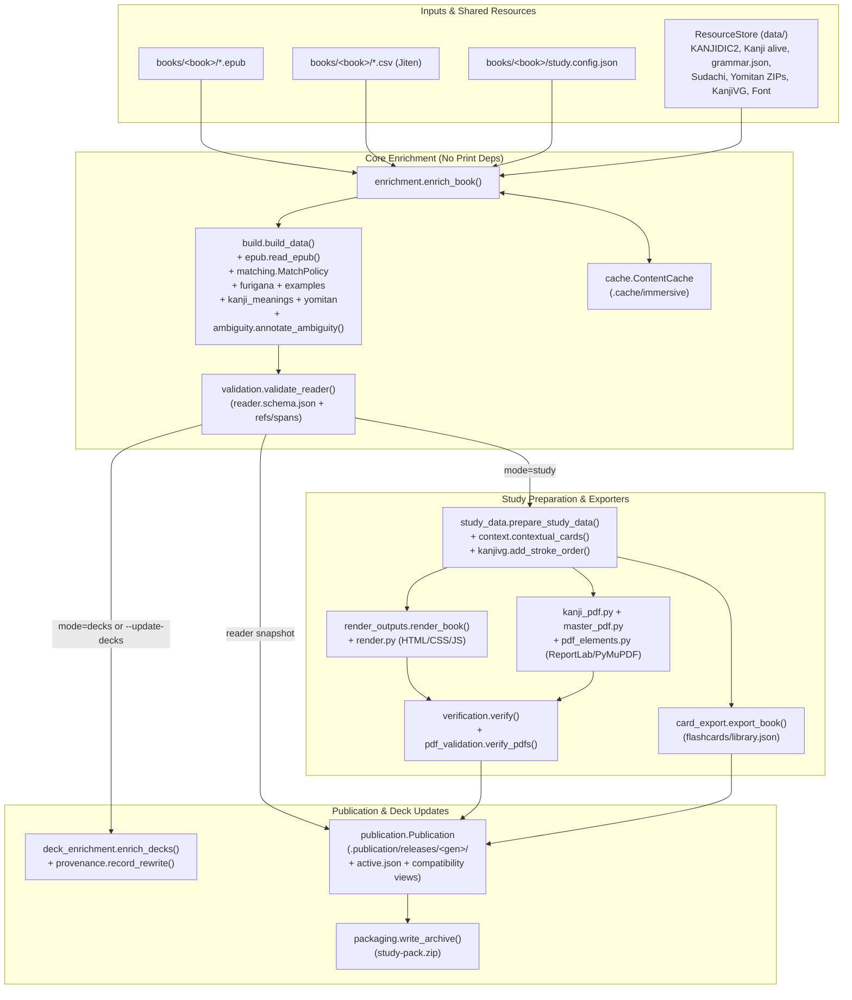

# Immersive Reading — LLM Wiki & Codebase Reference (`enrichement-extractor`)

> **Purpose:** High-density, source-linked architectural and operational knowledge base for AI agents and developers working on [`enrichement-extractor`](enrichement-extractor) and downstream reader integrations in `k:/immersive-reading`.

---

## 1. Quick Navigation & Wiki Map

| Wiki Page | Scope & When to Read |
| :--- | :--- |
| **[DEVELOPER_GUIDE.md](DEVELOPER_GUIDE.md)** | **Start here if you're new:** How `.NET 10` (`immersive-reader/`) and `Python` (`enrichement-extractor/`) connect, 5 end-to-end runtime flows, and "Where do I start to work on X?" |
| **[LLM-WIKI.md](LLM-WIKI.md)** *(this file)* | Single-file master map: architecture, module index, invariants, contracts, and task playbooks |
| **[wiki/index.md](wiki/index.md)** | Topic index, glossary of domain terms, and cross-reference directory |
| **[wiki/architecture-and-dataflow.md](wiki/architecture-and-dataflow.md)** | Pipeline stages, `reader` / `study` / `decks` modes, and base vs. `[print]` dependency boundaries |
| **[wiki/module-reference.md](wiki/module-reference.md)** | Complete file-by-file and symbol-by-symbol breakdown of `immersive/`, `scripts/`, and `tests/` |
| **[wiki/data-contracts-and-schemas.md](wiki/data-contracts-and-schemas.md)** | `reader.json`, `lookup.json`, `quality.json`, `study.config.json`, flashcard JSON, IDs, and coordinate systems |
| **[wiki/matching-and-linguistics.md](wiki/matching-and-linguistics.md)** | EPUB ruby extraction, Sudachi tokenization, `MatchPolicy`, Yomitan format-3, furigana, and ambiguity model |
| **[wiki/publication-caching-and-resources.md](wiki/publication-caching-and-resources.md)** | Atomic `.publication/` releases, OS locks, `ResourceStore` / `WorkerContext`, `ContentCache`, CSV provenance, and GC |
| **[wiki/study-exports-and-validation.md](wiki/study-exports-and-validation.md)** | `StudyData` preparation, kanji context, HTML/PDF rendering, 3-layer verification, and portable ZIP build |
| **[wiki/playbooks-and-invariants.md](wiki/playbooks-and-invariants.md)** | Non-negotiable system invariants, step-by-step recipes for common tasks, and verification commands |
| **[wiki/testing-and-fixtures.md](wiki/testing-and-fixtures.md)** | Synthetic `fixture()` helper, subprocess `NoPrint`/socket guards, and test matrix across all 19 test files |
| **[wiki/roadmap-and-open-work.md](wiki/roadmap-and-open-work.md)** | Refactoring status matrix, DOM source mapping & lookup design notes, and known real-book edge cases |
| **[specs/00-master-architecture-and-roadmap.md](specs/00-master-architecture-and-roadmap.md)** | .NET 10 + Photino.NET + AngleSharp + MeCab.DotNet EPUB Library, Reader, AI Companion & Global Settings specifications (`00`–`07`) |

---

## 2. System Overview

[`enrichement-extractor`](enrichement-extractor) (Python package `immersive-reading` v0.3.0, Python >= 3.12) is a **100% offline, deterministic Japanese book enrichment and study-pack generator**. It takes:
1. A Japanese `.epub` in `books/<book-name>/`
2. Vocabulary sources: one or more UTF-8 Jiten `.csv` decks (`Word`, `ReadingKana`, `Definitions`) in `books/<book-name>/`, **and/or** local Yomitan format-3 `.zip` dictionaries in `data/yomitan/`
3. Local dictionary/stroke resources in `data/` (`kanjidic2.xml.gz`, `kanji-alive/`, `kanjivg/source.zip`, `fonts/NotoSansJP-Regular.ttf`, optional `charts/`)
4. Optional per-book declarative overrides in `books/<book-name>/study.config.json`

And produces:
- **Core Reader Bundle** (`output/data/<book-id>/reader.json`, `lookup.json`, `quality.json`): source-linked chapters, paragraphs, sentences, Sudachi tokens, aligned vocabulary occurrences (with both Unicode code-point and UTF-16 offsets), kanji metadata, rule-based grammar candidates, example sentences with furigana, and explicit ambiguity/provenance records.
- **Supplementary Study Exports** (optional, in `study` mode):
  - **HTML Companion** (`output/html/<book-id>/` and `output/html/index.html`): offline searchable word/kanji lookups, chapter study pages, sets of 20 vocabulary words, grammar master, and review pages.
  - **Printable A4 PDFs** (`output/pdf/<book-id>/`): chapter kanji & vocabulary PDFs plus `kanji-master.pdf`, `vocabulary-master.pdf`, and `grammar-master.pdf` (requires optional `immersive-reading[print]` dependencies).
  - **Reusable Flashcard JSON** (`output/data/flashcards/library.json`): UI-agnostic book -> chapter -> card JSON.
  - **Packaged Archive** (`output/study-pack.zip`): manifest-verified bundle of published outputs.

---

## 3. Non-Negotiable Architectural Invariants

Always preserve these invariants when modifying the codebase:

1. **Zero LLM / Zero Network at Runtime**: Never add LLM calls, API keys, or runtime network requests. All segmentation (SudachiPy), dictionary lookups (Jiten CSV, Yomitan ZIP, KANJIDIC2, Kanji alive), and grammar detection ([`grammar.json`](enrichement-extractor/immersive/grammar.json)) are strictly local and deterministic.
2. **Never Translate Story Sentences**: English is used *only* for dictionary word/phrase glosses, kanji meanings, and grammar construction notes. Sentences in `reader.json` never have a `translation` field (enforced by [`validate_reader`](enrichement-extractor/immersive/validation.py#L127)).
3. **Strict Print Dependency Isolation**: Base modules (`enrichment.py`, `build.py`, `study_data.py`, `card_export.py`, `render.py`, `validation.py`, `resources.py`, `orchestration.py`, `publication.py`) **must never import** `reportlab`, `pymupdf`, `fontTools`, or `PIL` at top level. PDF dependencies are gated behind [`require_print()`](enrichement-extractor/immersive/capabilities.py#L5-L8) and loaded only when `pdf=True`.
4. **Source Input Immutability by Default**: `reader` mode (`enrich_book`, `cli enrich`, `pipeline --reader-only`) and default `study` builds must **never** modify input `.epub` or `.csv` files. Source CSV `first_appearance` updates happen *only* when `--decks-only`, `--update-decks`, or `cli decks` is explicitly requested, and must record write-ahead provenance in `.enrichment/deck-provenance.json` via [`provenance.py`](enrichement-extractor/immersive/provenance.py).
5. **No Automatic Semantic Disambiguation**: Reading/token alignment does not prove which dictionary sense is intended. Keep all source definition blocks in `definition_candidates` and reading ties in `ambiguities` ([`ambiguity.py`](enrichement-extractor/immersive/ambiguity.py)). Only explicit `study.config.json` (`context_glosses` or `print_context`) can mark a sense as `reviewed_override`.
6. **Thread-Scoped Tokenizers & Process-Scoped Stores**: [`ResourceStore`](enrichement-extractor/immersive/resources.py#L101-L350) is thread-safe within a single process (`os.getpid()` checked) and holds frozen (`MappingProxyType` / `tuple`) dictionary snapshots. [`WorkerContext`](enrichement-extractor/immersive/tokenization.py#L9-L66) owns stateful Sudachi tokenizers and an 8,192-entry LRU ruby cache for a single thread (`threading.current_thread()` checked). Never share a `WorkerContext` across threads.
7. **Paragraph & Token Boundaries**: Sentences, tokens, vocabulary occurrences, and regex grammar matches must never cross paragraph boundaries ([`MatchPolicy.contains`](enrichement-extractor/immersive/matching.py#L61-L65)). Multi-character phrase matches must align to token start/end boundaries, never arbitrary substrings inside larger words.
8. **Production Validation Under `python -O`**: Never use `assert` for data, schema, or security validation. Use [`require()`](enrichement-extractor/immersive/validation.py#L15-L18) or explicit `ValueError` / `ValidationError` / `PublicationError`.
9. **Atomic Staged Publication & Path Containment**: All file writes go through temporary files + `os.replace` or private staging directories (`.publication/staging/<generation>/`) sealed before switching `.publication/active.json`. Always validate paths with [`contained(root, name)`](enrichement-extractor/immersive/publication.py#L56-L67) to reject traversal (`..`), symlinks, and Windows junctions.

---

## 4. End-to-End Architecture Diagram



---

## 5. Module Index (`enrichement-extractor/immersive/`)

### Entry Points & Orchestration
- [`immersive/__init__.py`](enrichement-extractor/immersive/__init__.py) — Package version (`__version__ = "0.3.0"`).
- [`immersive/cli.py`](enrichement-extractor/immersive/cli.py) — Console script `immersive` (`build`, `enrich`, `decks` subcommands). Emits per-book JSON summaries to `stdout` and errors/warnings to `stderr`.
- [`immersive/pipeline.py`](enrichement-extractor/immersive/pipeline.py) — Console script `immersive-pipeline` and legacy [`run_stages()`](enrichement-extractor/immersive/pipeline.py#L24-L42) facade over `run_job`. Supports `--reader-only`, `--decks-only`, `--doctor`, `--skip-pdf`, `--skip-html`, `--skip-cards`, `--skip-package`, `--update-decks`.
- [`immersive/orchestration.py`](enrichement-extractor/immersive/orchestration.py) — Shared task executor: [`BuildOptions`](enrichement-extractor/immersive/orchestration.py#L16-L33), [`BookResult`](enrichement-extractor/immersive/orchestration.py#L36-L51), [`JobResult`](enrichement-extractor/immersive/orchestration.py#L55-L63), [`ExportFailure`](enrichement-extractor/immersive/orchestration.py#L65-L69), and [`run_job()`](enrichement-extractor/immersive/orchestration.py#L93-L108). Coordinates enrichment, input stamp verification, deck updates, staging, study exports, and atomic publication.
- [`immersive/jobs.py`](enrichement-extractor/immersive/jobs.py) — Cooperative cancellation: [`CancellationToken`](enrichement-extractor/immersive/jobs.py#L9-L17), [`CancelledError`](enrichement-extractor/immersive/jobs.py#L5-L6), [`check_cancelled()`](enrichement-extractor/immersive/jobs.py#L20-L22).
- [`immersive/capabilities.py`](enrichement-extractor/immersive/capabilities.py) — [`require_print()`](enrichement-extractor/immersive/capabilities.py#L5-L8) checks `reportlab`, `pymupdf`, `fontTools`, `PIL` via `importlib.util.find_spec` without importing them.
- [`immersive/doctor.py`](enrichement-extractor/immersive/doctor.py) — [`check()`](enrichement-extractor/immersive/doctor.py#L13-L56) capability-scoped runtime and resource health check (`reader`, `html`, `pdf`, `cards`).

### Core Reader Enrichment & Linguistics
- [`immersive/enrichment.py`](enrichement-extractor/immersive/enrichment.py) — Public reader API: [`EnrichmentReport`](enrichement-extractor/immersive/enrichment.py#L14-L19), [`enrich_book()`](enrichement-extractor/immersive/enrichment.py#L22-L70), [`write_reader_data()`](enrichement-extractor/immersive/enrichment.py#L79-L93).
- [`immersive/build.py`](enrichement-extractor/immersive/build.py) — Core analysis builder: [`load_decks()`](enrichement-extractor/immersive/build.py#L19-L52), [`load_kanjidic()`](enrichement-extractor/immersive/build.py#L55-L72), [`build_data()`](enrichement-extractor/immersive/build.py#L79-L351).
- [`immersive/epub.py`](enrichement-extractor/immersive/epub.py) — EPUB container/OPF/TOC/NCX/spine parser and ruby extractor: [`read_epub()`](enrichement-extractor/immersive/epub.py#L24-L147), [`uid()`](enrichement-extractor/immersive/epub.py#L11-L12), [`norm()`](enrichement-extractor/immersive/epub.py#L15-L16).
- [`immersive/matching.py`](enrichement-extractor/immersive/matching.py) — Unified reading and boundary alignment policy: [`MatchPolicy`](enrichement-extractor/immersive/matching.py#L54-L106), [`source_reading()`](enrichement-extractor/immersive/matching.py#L25-L28), [`inflected_reading_compatible()`](enrichement-extractor/immersive/matching.py#L30-L51).
- [`immersive/furigana.py`](enrichement-extractor/immersive/furigana.py) — EPUB-first + offline Sudachi furigana generator and okurigana aligner: [`furigana()`](enrichement-extractor/immersive/furigana.py#L77-L81), [`sentence_ruby()`](enrichement-extractor/immersive/furigana.py#L84-L89), [`align()`](enrichement-extractor/immersive/furigana.py#L18-L51), [`unresolved()`](enrichement-extractor/immersive/furigana.py#L92-L94).
- [`immersive/examples.py`](enrichement-extractor/immersive/examples.py) — Deterministic CSV-first / first-chapter-occurrence fallback example selector: [`select_example()`](enrichement-extractor/immersive/examples.py#L6-L33), [`selection_span()`](enrichement-extractor/immersive/examples.py#L36-L42).
- [`immersive/kanji_meanings.py`](enrichement-extractor/immersive/kanji_meanings.py) — Attributed learner meanings from Kanji alive (`ka_data.csv`) with KANJIDIC2 fallback: [`load_primary_meanings()`](enrichement-extractor/immersive/kanji_meanings.py#L22-L39), [`add_primary_meanings()`](enrichement-extractor/immersive/kanji_meanings.py#L42-L68).
- [`immersive/yomitan.py`](enrichement-extractor/immersive/yomitan.py) — Offline Yomitan format-3 ZIP importer: [`load_dictionary()`](enrichement-extractor/immersive/yomitan.py#L113-L217), [`vocabulary_entries()`](enrichement-extractor/immersive/yomitan.py#L220-L239), [`attach_dictionaries()`](enrichement-extractor/immersive/yomitan.py#L242-L268), [`glossary_text()`](enrichement-extractor/immersive/yomitan.py#L52-L82).
- [`immersive/ambiguity.py`](enrichement-extractor/immersive/ambiguity.py) — Source definition blocks, sense selection status, and span-level reading/entry ambiguity groups: [`annotate_ambiguity()`](enrichement-extractor/immersive/ambiguity.py#L8-L59).
- [`immersive/japanese.py`](enrichement-extractor/immersive/japanese.py) — Character helpers: [`hira()`](enrichement-extractor/immersive/japanese.py#L4-L5), [`is_kanji()`](enrichement-extractor/immersive/japanese.py#L8-L9), [`is_latin_or_digit()`](enrichement-extractor/immersive/japanese.py#L12-L13).
- [`immersive/text_index.py`](enrichement-extractor/immersive/text_index.py) — Precomputed [`utf16_offsets()`](enrichement-extractor/immersive/text_index.py#L5-L9) and binary-search [`SentenceIndex`](enrichement-extractor/immersive/text_index.py#L12-L21).
- [`immersive/grammar.json`](enrichement-extractor/immersive/grammar.json) — Curated finite grammar rules (regex, particle, and desire token rules).

### Resources, Caching, Publication & Provenance
- [`immersive/resources.py`](enrichement-extractor/immersive/resources.py) — [`ResourceBundle`](enrichement-extractor/immersive/resources.py#L48-L90), [`ResourceStore`](enrichement-extractor/immersive/resources.py#L101-L350), [`ResourceChangedError`](enrichement-extractor/immersive/resources.py#L92-L93), [`resource_worker()`](enrichement-extractor/immersive/resources.py#L353-L386), [`freeze()`](enrichement-extractor/immersive/resources.py#L21-L28), [`thaw()`](enrichement-extractor/immersive/resources.py#L31-L36).
- [`immersive/tokenization.py`](enrichement-extractor/immersive/tokenization.py) — Thread-scoped [`WorkerContext`](enrichement-extractor/immersive/tokenization.py#L9-L66) and thread-local fallback [`default_worker()`](enrichement-extractor/immersive/tokenization.py#L72-L82).
- [`immersive/cache.py`](enrichement-extractor/immersive/cache.py) — Checksummed `.json.gz` content cache: [`ContentCache`](enrichement-extractor/immersive/cache.py#L42-L140), [`reader_inputs()`](enrichement-extractor/immersive/cache.py#L142-L177), [`hydrate_reader()`](enrichement-extractor/immersive/cache.py#L180-L186).
- [`immersive/publication.py`](enrichement-extractor/immersive/publication.py) — Atomic staged releases and compatibility views: [`Publication`](enrichement-extractor/immersive/publication.py#L280-L646), [`PublicationLock`](enrichement-extractor/immersive/publication.py#L194-L245), [`read_manifest()`](enrichement-extractor/immersive/publication.py#L135-L168), [`snapshot_root()`](enrichement-extractor/immersive/publication.py#L171-L176), [`repair_views()`](enrichement-extractor/immersive/publication.py#L691-L696), [`contained()`](enrichement-extractor/immersive/publication.py#L56-L67).
- [`immersive/retention.py`](enrichement-extractor/immersive/retention.py) — Snapshot leases and conservative GC: [`open_snapshot()`](enrichement-extractor/immersive/retention.py#L57-L63), [`lease_manifest()`](enrichement-extractor/immersive/retention.py#L33-L53), [`prune_releases()`](enrichement-extractor/immersive/retention.py#L100-L157), [`prune_cache()`](enrichement-extractor/immersive/retention.py#L160-L191).
- [`immersive/deck_enrichment.py`](enrichement-extractor/immersive/deck_enrichment.py) — Explicit source CSV `first_appearance` writer: [`enrich_decks()`](enrichement-extractor/immersive/deck_enrichment.py#L11-L15).
- [`immersive/provenance.py`](enrichement-extractor/immersive/provenance.py) — Write-ahead CSV rewrite ledger (`.enrichment/deck-provenance.json`): [`read_ledger()`](enrichement-extractor/immersive/provenance.py#L13-L25), [`source_descriptor()`](enrichement-extractor/immersive/provenance.py#L28-L41), [`record_rewrite()`](enrichement-extractor/immersive/provenance.py#L44-L54).
- [`immersive/profiling.py`](enrichement-extractor/immersive/profiling.py) — Offline stage wall-time, RSS, `tracemalloc`, and `cProfile` benchmark runner: [`benchmark()`](enrichement-extractor/immersive/profiling.py#L59-L101).

### Study Preparation, Exporters & Validation
- [`immersive/study_data.py`](enrichement-extractor/immersive/study_data.py) — Renderer-agnostic study card preparation: [`StudyIndexes`](enrichement-extractor/immersive/study_data.py#L12-L31), [`StudyData`](enrichement-extractor/immersive/study_data.py#L35-L48), [`prepare_study_data()`](enrichement-extractor/immersive/study_data.py#L51-L77), [`study_reader_data()`](enrichement-extractor/immersive/study_data.py#L80-L88), [`grouped_vocabulary()`](enrichement-extractor/immersive/study_data.py#L136-L162), [`vocabulary_learning_sets()`](enrichement-extractor/immersive/study_data.py#L165-L176).
- [`immersive/context.py`](enrichement-extractor/immersive/context.py) — Source-grounded chapter word/reading/gloss selection for kanji study cards: [`contextual_cards()`](enrichement-extractor/immersive/context.py#L32-L167).
- [`immersive/kanjivg.py`](enrichement-extractor/immersive/kanjivg.py) — KanjiVG SVG stroke parser and asset copier: [`parse_glyph()`](enrichement-extractor/immersive/kanjivg.py#L10-L16), [`add_stroke_order()`](enrichement-extractor/immersive/kanjivg.py#L19-L42), [`copy_svg_assets()`](enrichement-extractor/immersive/kanjivg.py#L45-L67).
- [`immersive/card_export.py`](enrichement-extractor/immersive/card_export.py) — Flashcard JSON exporter (`output/data/flashcards/library.json`): [`export_book()`](enrichement-extractor/immersive/card_export.py#L9-L39), [`export()`](enrichement-extractor/immersive/card_export.py#L42-L73).
- [`immersive/render_outputs.py`](enrichement-extractor/immersive/render_outputs.py) — Study directory exporter orchestrating HTML, PDF, and study JSON files: [`render_book()`](enrichement-extractor/immersive/render_outputs.py#L8-L18).
- [`immersive/render.py`](enrichement-extractor/immersive/render.py) — HTML markup templates, `<ruby>`/`<mark>` example rendering, and legacy compatibility wrappers (`style.css`, `lookup.js`).
- [`immersive/library.py`](enrichement-extractor/immersive/library.py) — Multi-book HTML library index builder: [`library_page()`](enrichement-extractor/immersive/library.py#L9-L11), [`write_library_index()`](enrichement-extractor/immersive/library.py#L14-L39).
- [`immersive/pdf_elements.py`](enrichement-extractor/immersive/pdf_elements.py) — ReportLab font registration (`_PDF_LOCK`, [`pdf_session()`](enrichement-extractor/immersive/pdf_elements.py#L25-L30)) and custom Flowables ([`RubyText`](enrichement-extractor/immersive/pdf_elements.py#L33-L68), [`PracticeGrid`](enrichement-extractor/immersive/pdf_elements.py#L71-L88), [`StrokeOrder`](enrichement-extractor/immersive/pdf_elements.py#L91-L129)).
- [`immersive/kanji_pdf.py`](enrichement-extractor/immersive/kanji_pdf.py), [`immersive/master_pdf.py`](enrichement-extractor/immersive/master_pdf.py), [`immersive/study_pdf.py`](enrichement-extractor/immersive/study_pdf.py), [`immersive/pdf_charts.py`](enrichement-extractor/immersive/pdf_charts.py) — A4 PDF generators for chapter/master kanji, vocabulary, grammar, covers, and rotated Tofugu kana charts.
- [`immersive/validation.py`](enrichement-extractor/immersive/validation.py) — Layer 1 validation (no HTML/PDF deps): JSON Schema ([`reader.schema.json`](enrichement-extractor/immersive/reader.schema.json), [`config.schema.json`](enrichement-extractor/immersive/config.schema.json)), referential integrity, span/UTF-16 checks, ambiguity & Yomitan invariants: [`validate_reader()`](enrichement-extractor/immersive/validation.py#L82-L202), [`validate_config()`](enrichement-extractor/immersive/validation.py#L34-L35).
- [`immersive/verification.py`](enrichement-extractor/immersive/verification.py) — Layer 2 verification: persisted bundle checks, `learning_sets` invariants, HTML link/anchor/furigana verification: [`verify()`](enrichement-extractor/immersive/verification.py#L81-L86).
- [`immersive/pdf_validation.py`](enrichement-extractor/immersive/pdf_validation.py) — Layer 3 PDF verification (PyMuPDF + Pillow): page counts, license covers, blank page 2, bounding boxes, embedded fonts, white backgrounds, and preview contact sheets: [`verify_pdfs()`](enrichement-extractor/immersive/pdf_validation.py#L7-L10).
- [`immersive/packaging.py`](enrichement-extractor/immersive/packaging.py) — Manifest-verified `study-pack.zip` creator: [`package()`](enrichement-extractor/immersive/packaging.py#L33-L42), [`write_archive()`](enrichement-extractor/immersive/packaging.py#L11-L30).
- [`immersive/release.py`](enrichement-extractor/immersive/release.py) — Frozen `uv.lock` dependency closure and wheel/file hash verifier for [`scripts/build_portable.py`](enrichement-extractor/scripts/build_portable.py).

### .NET 10 Desktop EPUB Library, Reader & Study Pack Bridge (`immersive-reader/`)
- [`immersive-reader/src/ImmersiveReading.Library/LibraryManager.cs`](immersive-reader/src/ImmersiveReading.Library/LibraryManager.cs) & [`LibraryDatabase.cs`](immersive-reader/src/ImmersiveReading.Library/LibraryDatabase.cs) — High-scale (24k+ book) SQLite WAL + FTS5 EPUB library manager, nested virtual folders/series, manual tags, inheritable custom fields, and two-stage batch directory scanner.
- [`immersive-reader/src/ImmersiveReading.Enrichment/AngleSharpDomEnricher.cs`](immersive-reader/src/ImmersiveReading.Enrichment/AngleSharpDomEnricher.cs) & [`BookSchemeHandler.cs`](immersive-reader/src/ImmersiveReading.Enrichment/BookSchemeHandler.cs) — In-memory AngleSharp XHTML DOM enricher, `MeCab.DotNet` Japanese morphological plugin ([`JapaneseLanguagePlugin.cs`](immersive-reader/src/Plugins/ImmersiveReading.Plugins.Japanese/JapaneseLanguagePlugin.cs)), relative asset/CSS URL rewriter (`ir-book://`), and polyglot XHTML5 serializer.
- [`immersive-reader/src/ImmersiveReading.Dictionaries/DictionaryLookupEngine.cs`](immersive-reader/src/ImmersiveReading.Dictionaries/DictionaryLookupEngine.cs) — Sub-5ms indexed SQLite dictionary lookup engine, Yomitan format-3 ZIP importer ([`YomitanSqliteImporter.cs`](immersive-reader/src/ImmersiveReading.Dictionaries/YomitanSqliteImporter.cs)), KANJIDIC2/Kanji alive/KanjiVG importer ([`KanjidicImporter.cs`](immersive-reader/src/ImmersiveReading.Dictionaries/KanjidicImporter.cs)), and breadth-first rule deinflector ([`JapaneseDeinflector.cs`](immersive-reader/src/Plugins/ImmersiveReading.Plugins.Japanese/JapaneseDeinflector.cs)).
- [`immersive-reader/src/ImmersiveReading.Library/PythonStudyPackBridge.cs`](immersive-reader/src/ImmersiveReading.Library/PythonStudyPackBridge.cs) — Phase 4 Python study-pack bridge: inspects `.publication/active.json`, acquires OS-level byte-range snapshot leases (`.publication/leases/<generation>/<uuid>.lock`), discovers master/chapter PDFs and 20-word `vocabulary-sets.json`, and invokes `immersive.cli build|enrich`.
- [`immersive-reader/src/ImmersiveReading.Library/FlashcardMiningService.cs`](immersive-reader/src/ImmersiveReading.Library/FlashcardMiningService.cs) — Phase 4 1-click sentence flashcard exporter writing atomically to `output/data/flashcards/library.json` and `output/data/flashcards/mined-anki.tsv` while strictly preserving untranslated Japanese story sentences.
- [`immersive-reader/src/ImmersiveReading.Core/Extensions/FeaturePluginContracts.cs`](immersive-reader/src/ImmersiveReading.Core/Extensions/FeaturePluginContracts.cs), [`ReaderContextService.cs`](immersive-reader/src/ImmersiveReading.Enrichment/ReaderContextService.cs), & [`SnippetEnricher.cs`](immersive-reader/src/ImmersiveReading.Enrichment/SnippetEnricher.cs) — Phase 5 extension bus (`IFeaturePlugin` / `FeaturePluginHost`), zero-spoiler passage extraction (`IReaderContextService`), and AngleSharp + MeCab HTML snippet enricher (`ISnippetEnricher`).
- [`immersive-reader/src/Plugins/ImmersiveReading.Plugins.AiCompanion/`](immersive-reader/src/Plugins/ImmersiveReading.Plugins.AiCompanion) — Phase 5 AI Companion plugin ([`AiCompanionPlugin.cs`](immersive-reader/src/Plugins/ImmersiveReading.Plugins.AiCompanion/AiCompanionPlugin.cs), [`ComprehensionQuizService.cs`](immersive-reader/src/Plugins/ImmersiveReading.Plugins.AiCompanion/ComprehensionQuizService.cs), [`VocabularyBudgetService.cs`](immersive-reader/src/Plugins/ImmersiveReading.Plugins.AiCompanion/VocabularyBudgetService.cs), [`PersonaChatService.cs`](immersive-reader/src/Plugins/ImmersiveReading.Plugins.AiCompanion/PersonaChatService.cs), [`OpenAiCompatibleLlmProvider.cs`](immersive-reader/src/Plugins/ImmersiveReading.Plugins.AiCompanion/Providers/OpenAiCompatibleLlmProvider.cs)).

---

## 6. Essential Commands (Run from `enrichement-extractor/`)

```powershell
# 1. Run full unit & regression test suite (19 test modules)
.venv\Scripts\python.exe -m unittest discover -s tests -v

# 2. Reader-only enrichment (fast, no PDFs/HTML, inputs untouched)
.venv\Scripts\python.exe -m immersive.cli enrich --book "books/<book_name>" --output output

# 3. Full study build (reader JSON + HTML + PDF + verification)
.venv\Scripts\python.exe -m immersive.cli build --book "books/<book_name>"

# 4. Full pipeline (reader JSON + HTML + PDF + verify + flashcards + study-pack.zip)
.venv\Scripts\python.exe -m immersive.pipeline --book "books/<book_name>"

# 5. Explicitly update first_appearance sort keys in source CSVs
.venv\Scripts\python.exe -m immersive.cli decks --book "books/<book_name>"

# 6. Environment & resource health check (reader-only vs full)
.venv\Scripts\python.exe -m immersive.pipeline --doctor --reader-only
.venv\Scripts\python.exe -m immersive.pipeline --doctor

# 7. Standalone output verification & publication inspection
.venv\Scripts\python.exe -m immersive.verification --output output --no-previews
.venv\Scripts\python.exe -m immersive.publication status --output output

# 8. Dry-run or apply release & cache retention
.venv\Scripts\python.exe -m immersive.retention --output output --cache-dir .cache/immersive
```

---

## 7. Quick Playbooks for Common Tasks

- **Integrating with a Reader Application**: Use [`enrich_book()`](enrichement-extractor/immersive/enrichment.py#L22-L70) or [`run_job(..., options=BuildOptions(mode="reader"))`](enrichement-extractor/immersive/orchestration.py#L93-L108) with a long-lived [`ResourceStore`](enrichement-extractor/immersive/resources.py#L101-L350) and [`ContentCache`](enrichement-extractor/immersive/cache.py#L42-L140). Read published outputs under a lease via [`open_snapshot(output, book_id, kind="reader")`](enrichement-extractor/immersive/retention.py#L57-L63). See [wiki/data-contracts-and-schemas.md](wiki/data-contracts-and-schemas.md).
- **Modifying Reader Schema or Enrichment Fields**:
  1. Update [`immersive/build.py`](enrichement-extractor/immersive/build.py) (or relevant sub-module).
  2. Update [`immersive/reader.schema.json`](enrichement-extractor/immersive/reader.schema.json).
  3. Add semantic invariant checks in [`immersive/validation.py`](enrichement-extractor/immersive/validation.py).
  4. Ensure any new module file is listed in `READER_FILES` in [`immersive/cache.py`](enrichement-extractor/immersive/cache.py#L24-L26) so cache keys invalidate automatically when code changes.
- **Modifying Matching or Furigana Rules**: Edit [`immersive/matching.py`](enrichement-extractor/immersive/matching.py) or [`immersive/furigana.py`](enrichement-extractor/immersive/furigana.py). Run [`tests/test_matching_regressions.py`](enrichement-extractor/tests/test_matching_regressions.py) and [`tests/test_ambiguity.py`](enrichement-extractor/tests/test_ambiguity.py). Never weaken homograph or paragraph-boundary checks.
- **Adding Grammar Patterns**: Edit [`immersive/grammar.json`](enrichement-extractor/immersive/grammar.json). Every rule needs unique `id`, `label`, `meaning`, `note`, and either a valid `regex` or `token` (`"particle"` + `form` or `"desire"`). Validated automatically by [`ResourceStore.grammar()`](enrichement-extractor/immersive/resources.py#L190-L212).

