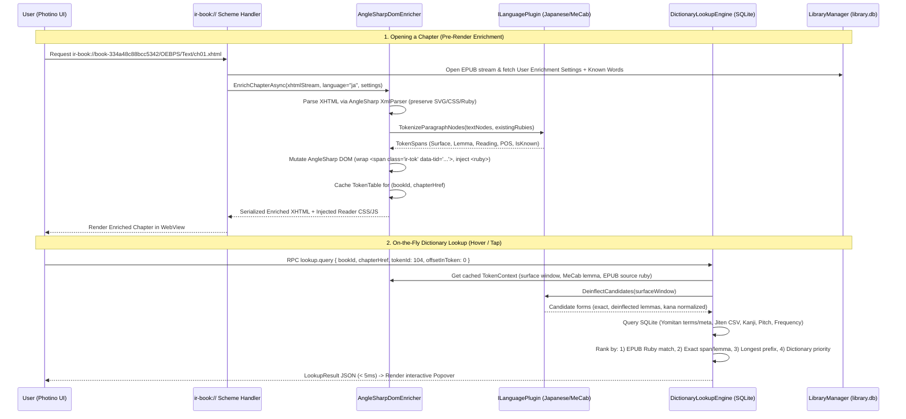

# 00 — Master Architecture & Implementation Roadmap: Immersive Reading (.NET + Photino.NET)

> **Status:** Fully Implemented & Verified (Phases 1–5 Complete)  
> **Target Runtime:** .NET 10 (`net10.0`, latest stable release installed on workspace)  
> **UI Framework:** Photino.NET (native OS WebView2 on Windows / WebKitGTK on Linux / WKWebView on macOS)  
> **Core Enrichment Stack:** AngleSharp (DOM parsing & pre-render HTML/XHTML mutation) + MeCab.DotNet (Japanese morphological analysis) + Pluggable Language Architecture (`ILanguagePlugin`)

---

## 1. Executive Summary & Vision

The **Immersive Reading Desktop Application** is a local-first, offline EPUB library manager and interactive reading environment built on **.NET 10** and **Photino.NET**. It is designed around three core architectural pillars:

1. **Pre-Render DOM Enrichment via AngleSharp**:
   - Before an EPUB chapter (`*.xhtml` / `*.html`) is rendered by the Photino WebView, the .NET backend intercepts the chapter stream, parses it into a live DOM using **AngleSharp**, and passes it through a **Language Enrichment Pipeline**.
   - The pipeline tokenizes text nodes (respecting existing `<ruby>` tags and inline markup) and injects structured semantic markup—interactive token spans (`<span class="ir-tok">`), configurable furigana (`<ruby>`), vocabulary mastery highlights, pitch/tone indicators, or grammar cues—directly into the DOM before serializing it to the renderer.
2. **Instant On-the-Fly Dictionary Lookup**:
   - Hovering or clicking any word in the rendered text triggers a sub-5ms lookup over Photino IPC (or via custom `ir-book://` scheme).
   - Because tokens and character offsets are pre-annotated in the DOM by AngleSharp + the active language plugin, the backend already knows the exact surface span, morphological lemma, reading (prioritizing author EPUB `<ruby>` over tokenizer guesses), and surrounding sentence context, while also running longest-prefix substring + deinflection matching against local SQLite-indexed **Yomitan format-3 dictionaries**, **Jiten CSV decks**, and **KANJIDIC2 / Kanji alive / KanjiVG** resources.
3. **Language-Agnostic Plugin Architecture (`ILanguagePlugin`)**:
   - All language-specific logic—tokenization, deinflection/lemmatization, ruby/phonetic annotation, reading normalization, and character decomposition—is encapsulated behind clean .NET interfaces (`ILanguagePlugin`, `ITextTokenizer`, `IDeinflector`, `IDomEnricher`).
   - **Japanese (`ImmersiveReading.Plugins.Japanese`)** is the flagship built-in plugin powered by **MeCab.DotNet** + rule-based deinflection. Additional languages (Chinese with Jieba/Pinyin, Korean with MeCab-ko, Spanish/German/Russian with morphological lemmatizers) can be dropped in as plugins without modifying the core reader, library, or UI.

---

## 2. Specification Index

| Document | Scope |
| :--- | :--- |
| **[00-master-architecture-and-roadmap.md](00-master-architecture-and-roadmap.md)** *(this file)* | Solution structure, technology choices, coexistence with `enrichement-extractor`, and vertical-slice runnable roadmap |
| **[01-epub-library-management-spec.md](01-epub-library-management-spec.md)** | EPUB ingestion, `book-<16 hex>` identity, hierarchical folders/collections (`Japanese -> Seinen -> Series -> Volumes`), manual tags, SQLite schema, and `enrichement-extractor` interoperability |
| **[02-prerender-enrichment-and-plugin-spec.md](02-prerender-enrichment-and-plugin-spec.md)** | `ILanguagePlugin` SDK, AngleSharp XHTML AST walker, `<ruby>` preservation, pre-render DOM injection rules, and `MeCab.DotNet` Japanese implementation |
| **[03-onthefly-dictionary-lookup-spec.md](03-onthefly-dictionary-lookup-spec.md)** | Sub-5ms lookup engine, Yomitan format-3 SQLite indexing, longest-prefix + deinflection algorithm, homograph/ruby resolution, and flashcard/word mining |
| **[04-photino-reader-ui-and-ipc-spec.md](04-photino-reader-ui-and-ipc-spec.md)** | Photino.NET host setup, `ir-book://` custom scheme interceptor, JSON-RPC IPC protocol, vertical/horizontal EPUB pagination, and UI components |
| **[05-extensibility-and-ai-companion-spec.md](05-extensibility-and-ai-companion-spec.md)** | Unified `IImmersivePlugin` architecture, sandboxed SQLite WAL, reactive JSON configuration, `@ir/sdk` slot extensions, Reading Comprehension Quizzes (MCQ $\rightarrow$ Freeform from just-read text), $n+1$ Vocabulary-Constrained Persona Chat (spoiler-safe + MeCab-verified), and `ILlmProvider` SDK |
| **[06-junior-developer-implementation-plan.md](06-junior-developer-implementation-plan.md)** | Step-by-step Junior Developer Implementation Guide & Ticket Backlog (`TASK-2.1` through `TASK-5.4`) for Phases 2–5 |
| **[07-global-configuration-and-settings-spec.md](07-global-configuration-and-settings-spec.md)** | Centralized Global Configuration screen, `app_settings` SQLite storage, CSS custom properties engine, and live LLM/Directory/Reader updates |

### 2.1 Executable Gherkin BDD Feature Specifications (`specs/features/`)

| Gherkin Feature File | Phase & Coverage |
| :--- | :--- |
| **[01-library-ingestion-and-24k-scanning.feature](features/01-library-ingestion-and-24k-scanning.feature)** | `@phase1` — Deterministic `book-<16 hex>` ID parity, OPF + ISBN extraction, Japanese filename heuristics, two-stage 24,000-book parallel scanner, and `< 50 ms` FTS5 paginated queries |
| **[02-library-hierarchy-tags-and-custom-fields.feature](features/02-library-hierarchy-tags-and-custom-fields.feature)** | `@phase1` — Nested virtual folders (`Japanese -> Seinen -> Series -> Volumes`), numeric volume sorting, single/bulk metadata editing + OPF reset, manual tags, and multi-level custom fields (`jiten.moe` links with inheritance) |
| **[03-prerender-anglesharp-enrichment-and-plugins.feature](features/03-prerender-anglesharp-enrichment-and-plugins.feature)** | `@phase2` — `ILanguagePlugin` SDK, AngleSharp ruby-aware DOM enrichment, author `<ruby>` priority over MeCab, okurigana alignment, and `<svg>`/inline tag safety |
| **[04-onthefly-dictionary-lookup-and-vocab.feature](features/04-onthefly-dictionary-lookup-and-vocab.feature)** | `@phase3` — `< 5 ms` dictionary lookup, verb/adjective deinflection, 16-char token-boundary prefix scanning, homograph disambiguation, KanjiVG stroke cards, and live DOM vocabulary status updates |
| **[05-photino-reader-and-study-pack-bridge.feature](features/05-photino-reader-and-study-pack-bridge.feature)** | `@phase2` / `@phase4` — `ir-book://` custom scheme chapter enrichment & relative asset streaming, path-traversal security, token-level progress persistence, and `enrichement-extractor` study pack bridge |
| **[06-ai-comprehension-and-n-plus-one-persona-chat.feature](features/06-ai-comprehension-and-n-plus-one-persona-chat.feature)** | `@phase5` — Zero-spoiler passage extraction, adaptive comprehension quizzes (`MultipleChoice` $\rightarrow$ `Guided` $\rightarrow$ `FreeForm`), and spoiler-safe $n+1$ persona chat verified by `MeCab.DotNet` |
| **[07-global-configuration-and-settings.feature](features/07-global-configuration-and-settings.feature)** | `@config` — Centralized application settings, live theme/color updates, directories, LLM endpoint connectivity, and category reset |

---

## 3. Technology Stack (.NET 10)

| Layer | Package / Technology | Version / Notes | Why Chosen |
| :--- | :--- | :--- | :--- |
| **Runtime & Language** | .NET 10 (`net10.0`), C# 14 | SDK `10.0.302` installed | Latest stable release; `Span<T>`, fast UTF-8/UTF-16 slicing, native AOT / self-contained publishing support. |
| **Desktop Shell & UI** | `Photino.NET` | Latest stable (`>= 3.2.x`) | Lightweight cross-platform OS WebView wrapper (WebView2 on Windows) with custom URI scheme interception (`RegisterCustomSchemeHandler`) and low-overhead bidirectional IPC. |
| **DOM Parsing & Mutation** | `AngleSharp` | `>= 1.1.2` | Standards-compliant HTML5 & XHTML (`XmlParser`) DOM in pure .NET. Allows safe AST traversal, text-node splitting, and attribute/element injection before serialization. |
| **Japanese Morphology** | `MeCab.DotNet` | `>= 1.1.0` | Pure managed C# port of MeCab; zero native C++ DLL deployment headaches, fast lattice tokenization, supports IPADic and custom/UniDic binary dictionaries. |
| **Database & Indexing** | `Microsoft.Data.Sqlite` + `Dapper` (or raw ADO.NET) | `>= 10.0.0` | Stores library metadata, reading progress, user vocabulary state, and indexed Yomitan/KANJIDIC2 dictionaries for sub-millisecond lookups. |
| **Archive & Compression** | `System.IO.Compression` | Built-in .NET 10 | Streaming read of `.epub` archives, Yomitan `.zip` dictionaries, and `.gz` resources without extracting to disk. |
| **Testing** | `xUnit` | `>= 2.9.x` | Unit and integration testing for EPUB parsing, AngleSharp DOM enrichment, MeCab tokenization, dictionary lookup, and IPC handlers. |

---

## 4. Solution & Directory Structure

```text
k:/immersive-reading/
├── ImmersiveReading.sln
├── specs/                                           # Architecture & engineering specifications
│   ├── 00-master-architecture-and-roadmap.md
│   ├── 01-epub-library-management-spec.md
│   ├── 02-prerender-enrichment-and-plugin-spec.md
│   ├── 03-onthefly-dictionary-lookup-spec.md
│   └── 04-photino-reader-ui-and-ipc-spec.md
├── src/
│   ├── ImmersiveReading.Core/                       # Zero-UI contracts, models & Plugin SDKs
│   │   ├── Plugins/                                 # ILanguagePlugin, ITextTokenizer, IDeinflector, IDomEnricher
│   │   ├── Extensions/                              # IFeaturePlugin, ILlmProvider, IComprehensionTutor, IPersonaChatEngine
│   │   ├── Epub/                                    # EpubArchiveReader, EpubPackage, SpineItem, TocItem
│   │   ├── Dictionaries/                            # IDictionaryLookupService, LookupQuery, LookupResult
│   │   └── Library/                                 # BookRecord, LibraryFolderNode, BookSeriesInfo, TagRecord, ReadingProgress
│   ├── ImmersiveReading.Enrichment/                 # AngleSharp pre-render pipeline
│   │   ├── AngleSharpDomEnricher.cs                 # XHTML parser, text-node walker, ruby-safe wrapper
│   │   ├── DomNodeCoordinateMap.cs                  # Maps DOM nodes <-> chapter token/character offsets
│   │   ├── RubyInjector.cs                          # Injects/filters <ruby> tags based on user settings
│   │   └── ChapterEnrichmentCache.cs                # In-memory & disk cache of enriched chapter XHTML
│   ├── ImmersiveReading.Dictionaries/               # SQLite dictionary engine & importers
│   │   ├── YomitanSqliteImporter.cs                 # Format-3 Yomitan ZIP -> SQLite indexer
│   │   ├── KanjidicImporter.cs                      # KANJIDIC2 + Kanji alive + KanjiVG loader
│   │   ├── JitenCsvDeckService.cs                   # Reads/updates Jiten CSVs & study.config.json
│   │   └── DictionaryLookupEngine.cs                # Longest-prefix + deinflection + ruby-priority lookup
│   ├── ImmersiveReading.Library/                    # Library catalog, folders, tags & study-pack bridge
│   │   ├── LibraryDatabase.cs                       # SQLite schema migrations & queries (library.db)
│   │   ├── LibraryManager.cs                        # Import EPUB, compute book-<16 hex> ID, extract cover
│   │   ├── FolderAndTagOrganizer.cs                 # Nested virtual folders (Japanese -> Seinen -> Series) & manual tags
│   │   ├── VocabularyTracker.cs                     # Tracks New/Learning/Known words & computes n+1 budgets
│   │   └── PythonStudyPackBridge.cs                 # Reads/triggers enrichement-extractor study packs
│   ├── Plugins/
│   │   ├── ImmersiveReading.Plugins.Japanese/       # Built-in Japanese plugin (MeCab.DotNet)
│   │   │   ├── JapaneseLanguagePlugin.cs
│   │   │   ├── MeCabTokenizerAdapter.cs             # MeCabTagger wrapper + POS/reading normalizer
│   │   │   ├── JapaneseDeinflector.cs               # Verb/adjective/auxiliary rule deinflector
│   │   │   └── OkuriganaRubyAligner.cs              # Aligns kanji stems vs okurigana for <ruby>
│   │   ├── ImmersiveReading.Plugins.Whitespace/     # Built-in fallback plugin for space-delimited languages
│   │   └── ImmersiveReading.Plugins.AiCompanion/    # Optional AI Comprehension Quiz & n+1 Persona Chat plugin
│   │       ├── ComprehensionQuizService.cs          # Generates & grades MCQ -> Freeform questions from just-read text
│   │       ├── PersonaChatService.cs                # Spoiler-safe persona chat with MeCab n+1 vocabulary enforcement
│   │       └── Providers/                           # Ollama / OpenAI-compatible / Local LLM adapters
│   └── ImmersiveReading.App/                        # Photino.NET Desktop Host & Frontend UI
│       ├── Program.cs                               # PhotinoWindow bootstrap & DI registration
│       ├── SchemeHandlers/                          # ir-book:// and ir-app:// custom scheme handlers
│       ├── Rpc/                                     # Typed JSON-RPC dispatcher + extensible plugin RPC router
│       └── wwwroot/                                 # HTML/CSS/JS frontend (Library tree, Reader, Popover, Extension drawers)
├── tests/
│   ├── ImmersiveReading.Core.Tests/
│   ├── ImmersiveReading.Enrichment.Tests/           # AngleSharp DOM mutation & ruby preservation tests
│   ├── ImmersiveReading.Dictionaries.Tests/         # Yomitan import, deinflection & lookup accuracy tests
│   └── ImmersiveReading.Plugins.Japanese.Tests/     # MeCab tokenization & okurigana alignment tests
└── enrichement-extractor/                           # Existing Python offline study-pack & PDF generator
```

---

## 5. System Dataflow Diagram



---

## 6. Synergy & Coexistence with `enrichement-extractor`

The .NET application and the Python [`enrichement-extractor`](../enrichement-extractor) share the exact same workspace (`k:/immersive-reading`) and resource/data conventions:

1. **Identical Book IDs (`book-<16 hex>`)**:
   - Both systems compute `"book-" + SHA256(epub_bytes).ToHexString()[..16].ToLowerInvariant()`. A book imported into the .NET library immediately matches its folder in `enrichement-extractor/output/` and `books/<book>/`.
2. **Shared Resource Directory (`enrichement-extractor/data/`)**:
   - The .NET app can directly read `data/kanjidic2.xml.gz`, `data/kanji-alive/ka_data.csv`, `data/kanjivg/source.zip`, `data/yomitan/*.zip`, and `data/fonts/NotoSansJP-Regular.ttf` without duplicating gigabytes of dictionary files.
3. **Live On-the-Fly Enrichment + Optional Deep Study Packs**:
   - **Inside the .NET Reader (Real-time)**: AngleSharp + MeCab.DotNet enrich any EPUB chapter on the fly in milliseconds as the user flips pages—no pre-build step required to start reading a new EPUB!
   - **Pre-built `reader.json` / Study Pack Integration**: If a book has already been enriched by `enrichement-extractor` (or if the user clicks *"Generate Printable Study Pack / PDFs"* in the .NET Library UI, which invokes `immersive.cli build` in the background), the .NET app links directly to the generated PDFs, 20-word learning sets (`vocabulary-sets.json`), and verified `reader.json` occurrences.

---

## 7. Phased Implementation Roadmap (Runnable Vertical Slices)

> [!IMPORTANT]
> **Deliverable Guarantee & Priority Order:** **Library Management for large collections (~24,000+ EPUBs)** is the primary starting point (Phase 1). Every single phase ends with a **complete, runnable desktop application (`dotnet run --project src/ImmersiveReading.App`)** that can be taken into daily use immediately, plus passing automated xUnit tests.

### Phase 1: High-Scale (24k+ Books) EPUB Library Manager Desktop App (`Core` + `Library` + `App`)
- **Goal**: Deliver a production-ready desktop Ebook Library Manager capable of indexing, organizing, searching, and curating **24,000+ Japanese EPUBs** smoothly.
- **Scope**:
  - **Fast Multi-Threaded EPUB Scanner & Importer**:
    - Parallel ZIP central-directory OPF metadata & cover extractor (scans only `container.xml`, `.opf`, and cover image without unpacking full books, committing in batched SQLite WAL transactions).
    - Extracts Title, Sort Title, Authors, Contributors, **ISBN-10/ISBN-13** (from `dc:identifier` / `opf:scheme` / regex), Publisher, Imprint, Published Date, Calibre/EPUB3 Series & Volume index, Language, and Synopsis.
    - Filename heuristic fallback parser (e.g., `[Author] Title Vol.01 (Imprint).epub`) when OPF metadata is messy or incomplete.
  - **Non-Destructive Editable Metadata (Single & Bulk Edit)**:
    - Edit any bibliographic field (`title`, `sort_title`, `authors`, `isbn`, `publisher`, `published_date`, `series_name`, `series_index`, `description`, `language`) in SQLite while preserving original OPF values for reference/reset—never mutating the `.epub` file on disk.
    - Bulk metadata editor for multi-selected books (e.g., assign Series, Folder, Author, Publisher, or auto-number volumes across 20 selected books at once).
  - **Hierarchical Virtual Folders (`library_folders`) & Manual Tags (`tags`)**:
    - Arbitrary nested tree (`Japanese` $\rightarrow$ `Shounen` / `Seinen` $\rightarrow$ `<Series Name>` $\rightarrow$ ordered volumes) + manual colored tags on both folders and books.
  - **Custom Fields on Any Level of the Library (`custom_field_definitions` & `custom_field_values`)**:
    - User-defined custom fields (`url`, `text`, `number`, `rating`, `boolean`, `select`, `file_path`) attachable to **Folders/Collections/Series** AND/OR **Individual Books**, with **hierarchical inheritance** (e.g., set a `jiten.moe` media link on a Series folder and all volumes inherit it, or override per volume!).
  - **24k-Scale Photino.NET Library UI**:
    - Server-side paginated + SQLite FTS5 instant search (< 5 ms across 24k books).
    - Dual view modes: **Virtualized Cover Grid** and **High-Density Metadata Table / Spreadsheet View** for rapid metadata curation.
- **Usable Product at End of Phase 1**:
  - A fast, standalone desktop Library Manager ready to organize, tag, fix metadata, attach `jiten.moe` links/CSVs, and browse a 24,000-book collection.

### Phase 2: Interactive EPUB Reader + Pre-Render AngleSharp & MeCab Enrichment (`Enrichment` + `Plugins.Japanese` + `App`)
- **Goal**: Open any book from the Library directly into the built-in Photino EPUB Reader with `ir-book://` streaming and pre-render AngleSharp + `MeCab.DotNet` DOM enrichment.
- **Scope**:
  - Implement `ir-book://` custom URI scheme handler serving EPUB chapters and relative assets (`../Images/...`, `../Styles/...`) directly from the ZIP archive.
  - Implement `ILanguagePlugin`, `JapaneseLanguagePlugin` (`MeCab.DotNet` + `OkuriganaRubyAligner` + `JapaneseDeinflector`), and `AngleSharpDomEnricher`.
  - Pre-render `<span class="ir-tok" data-tid="...">` and `<ruby class="ir-ruby-gen">` while preserving author `<ruby>` tags as ground truth.
  - Reader UI supporting `vertical-rl` and `horizontal-tb` pagination, bookmarks, reading progress persistence, and live furigana toggles (`All Kanji`, `Author Only`, `Hover`, `Off`).
- **Usable Product at End of Phase 2**:
  - Full Library Manager + Japanese/multi-language EPUB Reader with zero-CLS pre-render furigana and interactive token spans.

### Phase 3: Instant `< 5 ms` On-the-Fly Dictionary Lookup & Word Mining (`Dictionaries` + `App`) — **Completed**
- **Goal**: Hover or click any word in the reader to get an instant popover with dictionary definitions, deinflection chains, pitch accents, kanji stroke-order diagrams, and 1-click vocabulary status tracking.
- **Scope**:
  - Implement `YomitanSqliteImporter` (format-3 `.zip` $\rightarrow$ `dictionaries.db`), `KanjidicImporter` (`kanjidic2.xml.gz`, `ka_data.csv`, `kanjivg`), and `JapaneseDeinflector` (breadth-first verbal/adjective suffix analyzer).
  - Implement `DictionaryLookupEngine` (longest-prefix 16-char token-boundary scan + `JapaneseDeinflector` + EPUB `<ruby>` reading priority).
  - Implement `VocabularyTracker` in `library.db` (`vocabulary_state`).
  - Build the Reader Popover UI (`Words` & `Kanji` tabs, `New`/`Learning`/`Known`/`Ignored` status shortcuts `1/2/3/4` and live DOM class updates).
- **Usable Product at End of Phase 3**:
  - Complete reading + instant `< 5 ms` lookup + live vocabulary tracking workflow. Covered by 8/8 passing BDD specs in `ImmersiveReading.Dictionaries.Tests`.

### Phase 4: Study Pack Bridge & Flashcard Mining (`Library` + `App`)
- **Goal**: Connect the desktop library/reader with `enrichement-extractor` printable PDFs, 20-word learning sets, and 1-click sentence flashcard mining.
- **Scope**:
  - Implement `PythonStudyPackBridge` to read/trigger `enrichement-extractor` study packs and export mined sentence flashcards.
- **Usable Product at End of Phase 4**:
  - Seamless workflow between the 24k library manager, interactive reader, 1-click sentence cards, and printable A4 PDF study companions.

### Phase 5: Extensible Feature Plugin Host, AI Comprehension Tutor & $n+1$ Persona Chat (`Extensions` + `Plugins.AiCompanion` + `App`)
- **Goal**: Enable plug-and-play feature extensions (`IFeaturePlugin`) and ship the AI Reading Companion plugin for spoiler-free reading comprehension quizzes and $n+1$ vocabulary-constrained character persona chat.
- **Scope**:
  - Implement `IFeaturePlugin` host and `ILlmProvider` (local Ollama / `llama.cpp` / OpenAI-compatible / Claude / Gemini).
  - Implement `ComprehensionQuizService` (**Multiple-Choice (MCQ)** $\rightarrow$ **Guided Short Answer** $\rightarrow$ **Free-Form Answers** from just-read text).
  - Implement `PersonaChatService` (book character personas with spoiler boundary capped at `ReadingProgress` and `MeCab.DotNet`-verified $n+1$ vocabulary budget).
- **Usable Product at End of Phase 5**:
  - Full extensible reading suite with interactive comprehension testing and spoiler-free, $n+1$ vocabulary-calibrated character chat.

