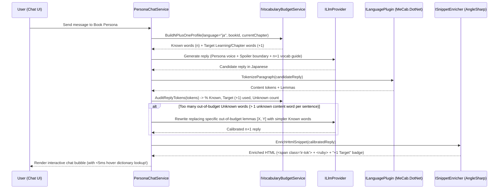

# 05 — Unified Extensibility Architecture, AI Reading Comprehension & $n+1$ Persona Chat Specification

> **Modules:** `ImmersiveReading.Core.Plugins`, `ImmersiveReading.App.Plugins`, `ImmersiveReading.Plugins.AiCompanion`  
> **Key Design Principle:** Opt-in, unified plugin architecture (`IImmersivePlugin`) providing sandboxed SQLite WAL databases, reactive JSON-Schema configuration, hot/cold reloads, and dynamic React UI slot mounting (`@ir/sdk`), while keeping the core EPUB reader and dictionary 100% deterministic and offline.

---

## 1. Unified Extensibility Architecture (`ImmersiveReading.Core.Plugins`)

Because an immersive reading platform naturally inspires new workflows—AI comprehension quizzes, $n+1$ character roleplay, grammar coaching, TTS audio synchronization, visual novel overlays, or custom exporters—the application provides a **Unified Plugin Architecture (`IImmersivePlugin`)** that unifies language packs (`ILanguagePlugin`) and feature plugins under a single lifecycle, configuration, database sandboxing, and UI slot architecture:

```text
┌───────────────────────────────────────────────────────────────────────────┐
│                    ImmersiveReading Plugin Host                           │
│  ┌─────────────────────┐  ┌──────────────────────┐  ┌──────────────────┐  │
│  │ IPluginConfigCtx    │  │ IPluginDatabaseCtx   │  │ IPluginEventBus  │  │
│  │ - schema.json       │  │ - SQLite WAL Sandbox │  │ - Pub/Sub Hub    │  │
│  │ - reactive merging  │  │ - Auto Migrations    │  │ - UI Push Events │  │
│  └──────────┬──────────┘  └──────────┬───────────┘  └────────┬─────────┘  │
│  ┌──────────┴──────────┐  ┌──────────┴───────────┐  ┌────────┴─────────┐  │
│  │ IReaderContextSvc   │  │ IVocabularyBudgetSvc │  │ ISnippetEnricher │  │
│  │ - Just-Read Window  │  │ - Known Words (n)    │  │ (AngleSharp DOM  │  │
│  │ - Zero-Spoiler Gate │  │ - Target Words (+1)  │  │  Token & Ruby)   │  │
│  └──────────┬──────────┘  └──────────┬───────────┘  └────────┬─────────┘  │
└─────────────┼────────────────────────┼───────────────────────┼────────────┘
              │                        │                       │
     ┌────────┴────────────────────────┴───────────────────────┴────────┐
     │             IImmersivePlugin Unified Host Manager                │
     ├─────────────────────────┬────────────────────────┬───────────────┤
     ▼                         ▼                        ▼               ▼
┌─────────────────────┐ ┌──────────────────────┐ ┌─────────────┐ ┌──────────────┐
│ Japanese Language   │ │ AI Companion Plugin  │ │ Grammar /   │ │ Future User  │
│ (RestartRequired)   │ │ (Hot Reloadable)     │ │ Audio / TTS │ │ Plugins      │
└─────────────────────┘ └──────────────────────┘ └─────────────┘ └──────────────┘
```

### 1.1 Core Extension Contracts

```csharp
namespace ImmersiveReading.Core.Plugins;

public interface IImmersivePlugin : IAsyncDisposable
{
    PluginManifest Manifest { get; }
    Task InitializeAsync(IPluginHostContext context, CancellationToken ct = default);
    Task EnableAsync(CancellationToken ct = default);
    Task DisableAsync(CancellationToken ct = default);
}

public interface IPluginHostContext
{
    string PluginId { get; }
    IPluginConfigContext Config { get; }
    IPluginDatabaseContext Database { get; }
    IPluginEventBus EventBus { get; }
    IReaderContextService ReaderContext { get; }
    IVocabularyBudgetService VocabularyBudget { get; }
    ISnippetEnricher SnippetEnricher { get; }

    void RegisterRpcAction(string action, PluginRpcHandler handler);
    void RegisterLanguagePlugin(ILanguagePlugin plugin, bool isFallback = false);
    void RegisterUiSlot(PluginSlotRegistration registration);
    void RegisterDomEnrichmentStage(IDomEnrichmentStage stage);
}
```

For backward compatibility with existing tests and modules, plugins may additionally implement the legacy `IFeaturePlugin` and `ILanguagePlugin` interfaces.

### 1.2 Zero-Spoiler `IReaderContextService`
Any plugin (especially AI comprehension or persona chat) needs access to what the user is reading **without ever accidentally reading ahead and spoiling future plot points**:

```csharp
public sealed record ReadPassageSlice(
    string BookId,
    string BookTitle,
    int ChapterIndex,
    string ChapterTitle,
    string SpineHref,
    int StartTokenId,
    int EndTokenId,               // Strictly <= user's current ReadingProgress.LocatorTokenId
    string PlainText,             // Normalized text of the slice
    IReadOnlyList<ParagraphSlice> Paragraphs
);

public interface IReaderContextService
{
    /// <summary>
    /// Extracts the passage between the user's previous checkpoint (or chapter start)
    /// and their current viewport locator token. Never includes text after the current viewport!
    /// </summary>
    Task<ReadPassageSlice> GetJustReadPassageAsync(
        string bookId,
        int maxCharacters = 3500,
        CancellationToken ct = default);

    /// <summary>
    /// Returns chapter summaries / text strictly up to the user's current ReadingProgress.
    /// </summary>
    Task<IReadOnlyList<ReadPassageSlice>> GetStoryContextUpToProgressAsync(
        string bookId,
        CancellationToken ct = default);
}
```

### 1.3 Reusable `ISnippetEnricher` (Interactive Dictionary inside Plugin UIs!)
Because `AngleSharpDomEnricher` and `ILanguagePlugin` (`MeCab.DotNet`) operate on any HTML/text fragment, `ISnippetEnricher` allows plugins to enrich AI-generated quiz questions, model answers, or persona chat messages with `<span class="ir-tok" data-tid="...">` and `<ruby class="ir-ruby-gen">`.
- **Result**: The user can hover or click any word inside an AI comprehension question or persona chat bubble and get the exact same `< 5 ms` dictionary popover and furigana behavior as the book itself!

---

## 2. Pluggable LLM Provider Abstraction (`ILlmProvider`)

AI features are completely decoupled from any specific vendor and work with both **100% local offline models** (Ollama, `llama.cpp`, LM Studio) and optional cloud APIs (OpenAI-compatible, Anthropic Claude, Google Gemini):

```csharp
public interface ILlmProvider
{
    string ProviderId { get; }       // "ollama", "openai-compatible", "gemini", "claude"
    string DisplayName { get; }
    bool IsLocalOffline { get; }     // True for localhost Ollama / llama.cpp

    Task<LlmStructuredResponse<T>> CompleteStructuredAsync<T>(
        LlmRequest request,
        JsonTypeInfo<T> schemaTypeInfo,
        CancellationToken ct = default);

    IAsyncEnumerable<string> StreamChatAsync(
        LlmRequest request,
        CancellationToken ct = default);
}
```

---

## 3. Feature 1: Progressive Reading Comprehension Engine (`ComprehensionQuizService`)

### 3.1 Pedagogical Goal: Multiple-Choice $\rightarrow$ Guided $\rightarrow$ Free-Form
When the user finishes a scene, page range, or chapter and clicks **"Check Comprehension"** in the Reader sidebar:
1. `ComprehensionQuizService` fetches the `ReadPassageSlice` for what was **just read** (e.g. the last 1,500–3,500 characters up to the current viewport token).
2. It checks the user's historical comprehension mastery tier (`ComprehensionStage`) for this book/language:
   - **Stage 1 — `MultipleChoice` (Recognition & Literal Comprehension)**:
     - 4 choices (`A`, `B`, `C`, `D`) testing plot events, character motives, or cause-and-effect from the passage just read.
     - Graded deterministically in C# (`selectedOptionIndex == correctOptionIndex`).
   - **Stage 2 — `GuidedShortAnswer` (Bridging / Key Detail Recall)**:
     - Prompts the reader to answer a specific question in 1 phrase or short sentence (with optional vocabulary hints from the passage).
   - **Stage 3 — `FreeForm` (Deep Comprehension & Production)**:
     - Open-ended comprehension questions (e.g., *"Why did the protagonist hesitate before opening the letter, and what does this reveal about their promise?"*).
     - The user can answer in either their native language (pure reading comprehension check) or the target language (reading + writing production check).
     - Evaluated against source-text evidence from `ReadPassageSlice`, returning:
       - `ComprehensionScore` (`0–100`)
       - `EvidenceQuote` + clickable `[Jump to Paragraph]` link in the EPUB
       - `MissingOrMisunderstoodPoints`
       - `LanguageFeedback` (if answered in Japanese)
       - `ModelAnswerHtml` (enriched via `ISnippetEnricher` so every word has furigana & hover lookup).

### 3.2 Automatic Progression Rule
- As the user scores $\ge 80\%$ across recent questions, the session mixer smoothly shifts the question distribution from `100% MultipleChoice` $\rightarrow$ `50% MultipleChoice / 50% GuidedShortAnswer` $\rightarrow$ `FreeForm`. The user can also manually select their preferred question mode at any time.

### 3.3 Comprehension SQLite Tables (`library.db`)
```sql
CREATE TABLE IF NOT EXISTS comprehension_sessions (
    session_id          TEXT PRIMARY KEY,
    book_id             TEXT NOT NULL REFERENCES books(book_id) ON DELETE CASCADE,
    chapter_index       INTEGER NOT NULL,
    start_token_id      INTEGER NOT NULL,
    end_token_id        INTEGER NOT NULL,
    passage_text        TEXT NOT NULL,
    created_at_utc      TEXT NOT NULL
);

CREATE TABLE IF NOT EXISTS comprehension_questions (
    question_id         TEXT PRIMARY KEY,
    session_id          TEXT NOT NULL REFERENCES comprehension_sessions(session_id) ON DELETE CASCADE,
    question_mode       TEXT NOT NULL,             -- 'mcq' | 'guided' | 'freeform'
    prompt_text         TEXT NOT NULL,
    options_json        TEXT,                      -- JSON array for MCQ options, NULL for freeform
    correct_option_idx  INTEGER,                   -- For MCQ
    rubric_json         TEXT NOT NULL,             -- Key facts & source paragraph citations
    user_answer         TEXT,
    score               REAL,                      -- 0.0 to 1.0
    feedback_json       TEXT,                      -- Graded explanation & model answer
    answered_at_utc     TEXT
);
```

---

## 4. Feature 2: $n+1$ Vocabulary-Constrained Chat & Book Personas (`PersonaChatService`)

### 4.1 Book Personas (`book_personas`)
Users can create or customize interactive character personas from the book they are reading (or general conversation tutors):
- **Character Identity & Voice**: Name (e.g., `エル / L`, `クスノキ`), Role, Personality traits, First/Second-person pronouns (`私`/`僕`/`俺`, `君`/`あなた`), and characteristic sentence-ending particles (`〜だね`, `〜かしら`).
- **Sample Dialogue Anchors**: Users can highlight any dialogue line in the EPUB reader and click **"Add as Persona Voice Sample"** so the persona mirrors the character's authentic tone from the book.
- **Strict Spoiler Guard**: Every persona chat prompt is bounded by `ReadingProgress` (`chapter_index`, `locator_token_id`). The persona only knows story events up to the exact paragraph the user has reached.

### 4.2 The $n+1$ ($i+1$) Vocabulary Constraint & MeCab Verification Loop
A common problem with LLM language chat is that models use advanced vocabulary far above the learner's level. Immersive Reading solves this by combining **SQLite `vocabulary_state`** with **local `MeCab.DotNet` morphological verification**:



### 4.3 How `IVocabularyBudgetService` Computes $n+1$
1. **The $n$ Set (Known Comfort Vocabulary)**:
   - All lemmas marked `WordStatus.Known` in `vocabulary_state`, plus core foundational particles/auxiliaries (`助詞`, `助動詞`) and high-frequency words the user has encountered $\ge K$ times without needing lookup.
2. **The $+1$ Set (Target Acquisition Pool)**:
   - Prioritizes words marked `WordStatus.Learning` in `vocabulary_state` and words from the **current chapter's 20-word learning set** (or Jiten CSV deck words that just appeared in the current chapter).
   - For each chat turn, `PersonaChatService` selects 3–8 contextually relevant $+1$ target words and encourages the persona to naturally weave 1 of them into the conversation.
3. **Visual $+1$ Highlighting in Chat**:
   - When the persona uses a $+1$ target word, its `<span class="ir-tok">` in the chat bubble receives a subtle `.ir-chat-target-plus1` glow badge, and hovering it opens the full dictionary popover!

### 4.4 Persona & Chat SQLite Tables (`library.db`)
```sql
CREATE TABLE IF NOT EXISTS book_personas (
    persona_id          TEXT PRIMARY KEY,
    book_id             TEXT REFERENCES books(book_id) ON DELETE CASCADE, -- NULL for global tutor persona
    name                TEXT NOT NULL,
    role_summary        TEXT NOT NULL DEFAULT '',
    speech_style        TEXT NOT NULL DEFAULT '',  -- Pronouns, endings, register notes
    voice_samples_json  TEXT NOT NULL DEFAULT '[]',-- Authentic quotes selected from the book
    max_spoiler_chapter INTEGER,                   -- NULL = dynamically follow ReadingProgress
    created_at_utc      TEXT NOT NULL
);

CREATE TABLE IF NOT EXISTS persona_chat_sessions (
    chat_id             TEXT PRIMARY KEY,
    persona_id          TEXT NOT NULL REFERENCES book_personas(persona_id) ON DELETE CASCADE,
    book_id             TEXT REFERENCES books(book_id) ON DELETE CASCADE,
    n_plus_one_strict   INTEGER NOT NULL DEFAULT 1,-- 1 = enforce MeCab n+1 verification loop
    created_at_utc      TEXT NOT NULL
);

CREATE TABLE IF NOT EXISTS persona_chat_messages (
    message_id          TEXT PRIMARY KEY,
    chat_id             TEXT NOT NULL REFERENCES persona_chat_sessions(chat_id) ON DELETE CASCADE,
    sender_role         TEXT NOT NULL,             -- 'user' | 'persona' | 'system'
    raw_text            TEXT NOT NULL,
    enriched_html       TEXT NOT NULL,             -- Pre-rendered with AngleSharp + MeCab
    plus_one_words_json TEXT NOT NULL DEFAULT '[]',-- Target +1 lemmas practiced in this turn
    comprehension_ratio REAL,                      -- % of content words in user's Known set
    created_at_utc      TEXT NOT NULL
);
```

