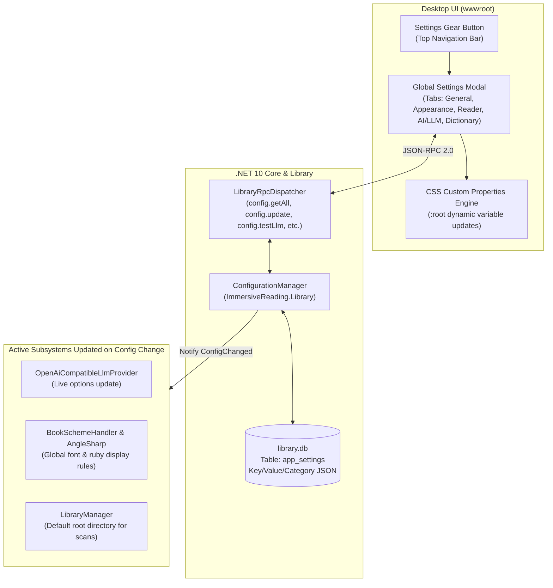

# 07 — Global Configuration & Settings System Specification

> **Status:** Specification Ready  
> **Target Solution:** `ImmersiveReading.sln` (.NET 10 + Photino.NET)  
> **Key Projects:** `ImmersiveReading.Core`, `ImmersiveReading.Library`, `ImmersiveReading.App`, `ImmersiveReading.Plugins.AiCompanion`  
> **Gherkin Feature:** [`specs/features/07-global-configuration-and-settings.feature`](features/07-global-configuration-and-settings.feature)

---

## 1. Executive Summary & Problem Statement

Currently, configuration settings across the application are scattered across several disjointed locations:
- **Scan Directories**: Handled as an ad-hoc parameter in `library.getBootstrapState` / `library.scanDirectory`.
- **LLM Endpoint & Model**: Hardcoded defaults in `LlmEndpointOptions` within `AiCompanionPlugin` with a lightweight drawer form in the reader topbar.
- **Reader Typography & Layout**: Stored per-book in `reading_progress.writing_mode`, without a global default theme, palette, or font configuration.
- **Dictionary Lookups**: Hardcoded limits for substring scan length (16 characters) and deinflection depth.

**The Solution:** A unified, centralized **Global Configuration System** providing a single, comprehensive Settings Screen in the desktop UI and a strongly-typed, SQLite-backed settings service in the .NET backend.

---

## 2. Architecture & Data Contracts



### 2.1 Configuration Model Schema (`ImmersiveReading.Core/Config/`)

Configuration is organized into five cohesive, strongly-typed categories:

```csharp
namespace ImmersiveReading.Core.Config;

public sealed record AppConfig(
    DirectorySettings Directories,
    AppearanceSettings Appearance,
    ReaderSettings Reader,
    LlmSettings Llm,
    DictionarySettings Dictionaries
);

public sealed record DirectorySettings(
    string DefaultScanDirectory = "",
    string ExtractorDirectory = "",
    string PythonExecutablePath = "",
    string CustomFlashcardsExportPath = ""
);

public sealed record AppearanceSettings(
    string ThemeMode = "dark",             // "dark", "light", "sepia", "oled", "system"
    string AccentColor = "#6366f1",        // Indigo default
    string BackgroundColor = "#111827",    // Slate-900
    string SurfaceColor = "#1f2937",       // Slate-800
    string TextColor = "#f3f4f6",          // Gray-100
    string TextMutedColor = "#9ca3af",     // Gray-400
    string BorderColor = "#374151",        // Gray-700
    double UiScale = 1.0                   // 0.85 to 1.3
);

public sealed record ReaderSettings(
    string DefaultWritingMode = "vertical-rl", // "vertical-rl" or "horizontal-tb"
    string JapaneseFontFamily = "Noto Sans JP, 'Hiragino Mincho ProN', 'Yu Mincho', serif",
    double BaseFontSizePx = 22.0,
    double LineHeightMultiplier = 1.85,
    string FuriganaDisplayMode = "always",     // "always", "hide-known", "hover-only", "never"
    string RubyTextColor = "#818cf8",          // Indigo-400
    string HighlightKnownColor = "transparent",
    string HighlightLearningColor = "rgba(245, 158, 11, 0.15)", // Amber tint
    string HighlightTargetPlusOneColor = "rgba(16, 185, 129, 0.25)", // Emerald tint
    bool AutoBookmarkOnChapterChange = true
);

public sealed record LlmSettings(
    string ActiveProfileName = "Ollama Local",
    string EndpointUrl = "http://localhost:11434/v1/chat/completions",
    string ModelId = "llama3.2",
    string ApiKey = "",
    int TimeoutSeconds = 15,
    double Temperature = 0.7,
    bool EnableOfflineHeuristicFallback = true,
    int QuizAccuracyPromotionThresholdPercent = 80, // Accuracy to advance stage
    int QuizPromotionRollingWindow = 5,
    int MaxUnknownWordsPerPersonaSentence = 1,
    bool AutoRewriteOutOfBudgetPersonaReplies = true
);

public sealed record DictionarySettings(
    int MaxScanCharacters = 16,
    int MaxDeinflectionDepth = 4,
    int MaxLookupResults = 12,
    bool AutoShowKanjiCardOnLookup = true,
    bool AutoCopySentenceOnCardMine = false,
    string CardExportFormat = "both" // "both" (library.json + TSV), "tsv", "json"
);
```

---

## 3. Database Persistence (`library.db`)

Configuration is stored in a clean, versioned key-value table inside `library.db`:

```sql
CREATE TABLE IF NOT EXISTS app_settings (
    setting_key TEXT PRIMARY KEY NOT NULL,
    category TEXT NOT NULL,
    value_json TEXT NOT NULL,
    updated_at_utc TEXT NOT NULL
);

CREATE INDEX IF NOT EXISTS idx_app_settings_category ON app_settings(category);
```

### 3.1 Migration & Default Seeding
When `LibraryDatabase.InitializeSchema()` executes:
1. The table `app_settings` is created if it does not exist.
2. If `app_settings` is empty, default records for each category are serialized and inserted with `updated_at_utc = datetime('now')`.
3. If user settings exist, only missing keys are added, preserving existing user overrides.

---

## 4. C# Service & Extension Architecture

### 4.1 `IConfigurationManager` Contract
```csharp
namespace ImmersiveReading.Library;

public interface IConfigurationManager
{
    AppConfig CurrentConfig { get; }
    AppConfig GetConfig();
    T GetCategory<T>(string category) where T : class, new();
    Task UpdateConfigAsync(AppConfig newConfig, CancellationToken ct = default);
    Task UpdateCategoryAsync<T>(string category, T categoryValue, CancellationToken ct = default);
    Task ResetDefaultsAsync(string? category = null, CancellationToken ct = default);
    event EventHandler<AppConfig>? ConfigChanged;
}
```

### 4.2 Dynamic Live Updates Without Restart
When `ConfigChanged` fires:
1. **`OpenAiCompatibleLlmProvider`**: Updates its internal `_options` dynamically so the next chat message or quiz uses the new endpoint/model immediately without restarting the app.
2. **`BookSchemeHandler`**: Uses the updated `JapaneseFontFamily`, `FuriganaDisplayMode`, and color variables for newly requested chapters and snippet renderings.
3. **Frontend Broadcast**: The `LibraryRpcDispatcher` sends a `config.changed` IPC notification to the WebView window, which applies updated CSS custom properties to the root DOM document.

---

## 5. JSON-RPC 2.0 API (`config.*`)

The following RPC routes are handled by `LibraryRpcDispatcher`:

| Method | Request Parameters | Response Result | Description |
| :--- | :--- | :--- | :--- |
| `config.getAll` | `{}` | `AppConfig` | Returns the entire configuration tree. |
| `config.getCategory` | `{"category": "appearance"}` | Category object | Returns only the requested category. |
| `config.update` | `{"category": "llm", "settings": { ... }}` | `{"ok": true, "updatedConfig": AppConfig}` | Validates and updates settings, triggers events, and saves to SQLite. |
| `config.resetDefaults` | `{"category": "all" \| categoryName}` | `{"ok": true, "updatedConfig": AppConfig}` | Resets the specified category or all settings to factory defaults. |
| `config.testLlmEndpoint` | `{"endpointUrl": "...", "apiKey": "...", "modelId": "..."}` | `{"success": true, "latencyMs": 142, "models": ["llama3.2", "qwen2.5:7b"]}` | Connects to the LLM endpoint, probes `/models` or `/tags`, and reports latency. |
| `config.selectDirectory` | `{"title": "Select Ebooks Folder", "initialPath": "..."}` | `{"cancelled": false, "selectedPath": "G:\\Ebooks"}` | Opens native folder picker dialog if running interactive OS, or validates path. |

---

## 6. Frontend UI: Global Settings Modal (`wwwroot/`)

### 6.1 Placement & Accessibility
- A **⚙️ Settings** icon button is added to the main topbar navigation in `index.html` (accessible from both the Library view and Reader view).
- Keyboard shortcut `Ctrl+,` (or `Cmd+,` on macOS) opens the modal from anywhere.
- `Escape` closes the modal without saving uncommitted drafts.

### 6.2 Modal Layout & Tab Structure
The modal features a clean two-column layout:
- **Left Sidebar**:
  1. 📁 **General & Directories**: Default scan folder, Python extractor path, flashcard export directory.
  2. 🎨 **Appearance & Themes**: Preset themes (Dark, Sepia, Light, OLED), custom color pickers for background, surface, and accents.
  3. 📖 **Reader Typography**: Default layout (`vertical-rl` vs `horizontal-tb`), font family dropdown with preview, font size slider, furigana mode toggles, ruby text color.
  4. 🧠 **AI & LLM Providers**: Endpoint profile selector (Ollama, LM Studio, OpenAI, Heuristic), API key field with show/hide toggle, model name, connection test button, quiz progression threshold.
  5. 📚 **Dictionary & Mining**: Search radius, max candidate results, auto-copy sentence toggle, flashcard export format.
- **Right Content Area**:
  - Scrollable form for the active tab.
  - Live preview widget (e.g., sample Japanese sentence with furigana reflecting typography/color changes in real time).
  - Bottom action bar: **Reset to Defaults**, **Cancel**, and **Save Changes**.

### 6.3 Real-Time CSS Variable Engine
The UI defines standard CSS variables on `:root`:
```css
:root {
  --bg-primary: #111827;
  --bg-surface: #1f2937;
  --text-primary: #f3f4f6;
  --text-muted: #9ca3af;
  --border-color: #374151;
  --accent-color: #6366f1;
  --ruby-color: #818cf8;
  --reader-font: "Noto Sans JP", sans-serif;
  --reader-font-size: 22px;
  --reader-line-height: 1.85;
}
```
When appearance settings change, JavaScript applies them directly to `document.documentElement.style.setProperty(...)`, giving instantaneous feedback across the entire application without a page reload.

---

## 7. Implementation Plan & Work Breakdown

| Task | Target Project | Deliverable |
| :--- | :--- | :--- |
| **`TASK-CFG.1`** | `ImmersiveReading.Core` | Create `AppConfig` and category records in `ImmersiveReading.Core/Config/AppConfig.cs`. |
| **`TASK-CFG.2`** | `ImmersiveReading.Library` | Add `app_settings` schema migration in `LibraryDatabase.cs` and implement `ConfigurationManager.cs`. |
| **`TASK-CFG.3`** | `ImmersiveReading.App` | Wire `ConfigurationManager` into `Program.cs` and expose `config.*` RPC methods in `LibraryRpcDispatcher.cs`. |
| **`TASK-CFG.4`** | `ImmersiveReading.App/wwwroot` | Build Settings Modal in `index.html`, add CSS custom property bindings in `styles.css`, and add configuration controller in `app.js`. |
| **`TASK-CFG.5`** | `ImmersiveReading.Plugins.AiCompanion` | Connect `OpenAiCompatibleLlmProvider` to live configuration changes. |
| **`TASK-CFG.6`** | `tests/` | Create xUnit specification tests validating default seeding, updates, persistence, and invalid input rejection. |

