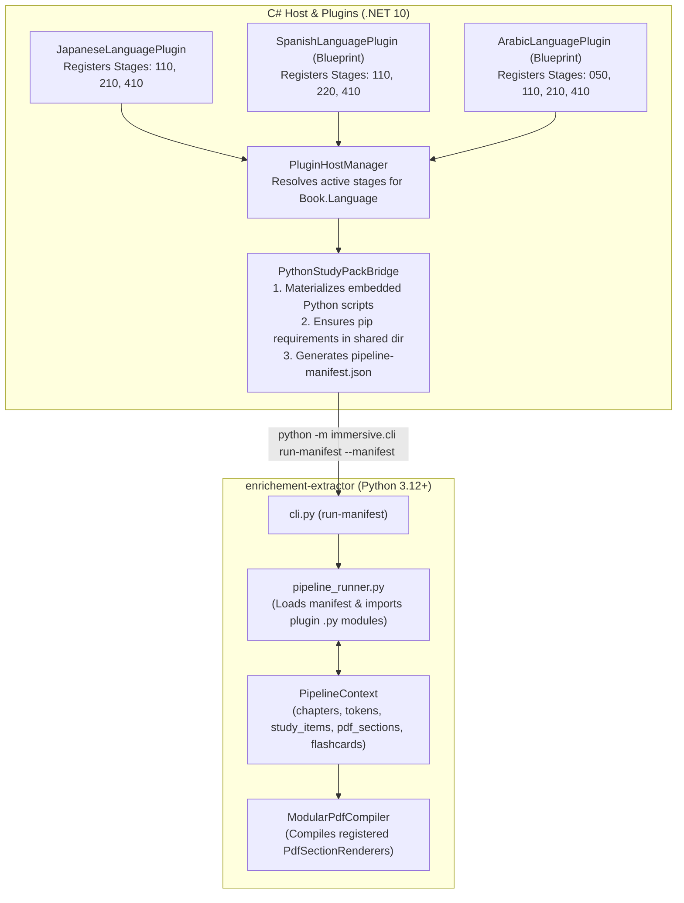

# 08 — Pluggable Python Pipeline & Study Pack Stages Specification

> **Modules:** `ImmersiveReading.Core.Plugins`, `ImmersiveReading.App.Plugins`, `ImmersiveReading.Library`, `enrichement-extractor.immersive.sdk`  
> **Key Design Principle:** Decouple `enrichement-extractor` from hardcoded Japanese assumptions into a language-agnostic, DAG-stage execution engine driven by C# plugins (`IImmersivePlugin`).

---

## 1. Architectural Overview & Design Goals

The offline Python pipeline (`enrichement-extractor`) is refactored into a **Pluggable Stage Architecture**:

1. **Zero Language Hardcoding in Core Python Engine:** `enrichement-extractor` serves as a pure execution runtime responsible for EPUB chapter extraction, DAG stage orchestration, shared data structures (`PipelineContext`), BiDi/font formatting helpers, and compiling modular ReportLab `Flowable` sections contributed by stages.
2. **Registered via `IPluginHostContext`:** Any C# plugin (`IImmersivePlugin`) can register one or more Python stages (`PythonStageDescriptor`), specifying target language(s), execution order (`0–499`), required `pip` packages, and the Python entrypoint class.
3. **Automatic Configuration Passthrough:** When `PythonStudyPackBridge` launches a build, it serializes active plugins' JSON configurations (`IPluginConfigContext.GetRawJson()`) directly into `pipeline-manifest.json` so Python stages automatically obey user settings from the React Settings UI.
4. **Isolated Per-Plugin Python Dependencies:** Missing `pip` requirements declared by enabled plugins are lazily installed into `.library-data/python-packages/` and injected into `PYTHONPATH`.



---

## 2. Canonical Pipeline Phases & Ordering Contract

Stages execute in ascending numeric `Order`. Plugins can hook into any phase or insert intermediate stages:

| Phase | Order Range | Mutates in `PipelineContext` | Description & Examples |
| :--- | :--- | :--- | :--- |
| **Phase 0: Core EPUB Ingestion** | `Built-in (0)` | `ctx.chapters` | Built into `enrichement-extractor`. Parses EPUB spine XHTML into clean chapter text blocks. |
| **Phase 1: Text Normalization** | `1 – 99` | `ctx.chapters`, `ctx.writing_direction` | Pre-tokenization cleanup. E.g., Arabic Tatweel/diacritic normalization (`Order: 50`), Japanese vertical punctuation normalization (`Order: 50`). |
| **Phase 2: Morphology & Tokenization** | `100 – 199` | `ctx.tokens`, `ctx.study_items` | Segments text into `ExtractedToken` items and initializes unique `StudyItem` records. E.g., `SudachiPy` (`110`), `spaCy` Spanish (`110`), `CAMeL Tools` Arabic (`110`). |
| **Phase 3: Linguistic & Dict Enrichment** | `200 – 299` | `ctx.study_items` | Populates `glosses`, `reading`, and language-specific `metadata` (KanjiVG strokes, Spanish irregular verb conjugation tables, Arabic trilateral root families). |
| **Phase 4: Pedagogical Filtering & Scoring** | `300 – 399` | `ctx.study_items`, `ctx.flashcards` | Merges external frequency lists (Jiten.moe CSV, CEFR lists), filters out known words, and selects $i+1$ target sentences for flashcards. |
| **Phase 5: Layout & Export Contribution** | `400 – 499` | `ctx.pdf_sections`, `ctx.artifacts` | Appends `PdfSectionRenderer` instances to `ctx.pdf_sections` so the core ReportLab compiler builds a language-tailored A4 Master Study Sheet. |

---

## 3. C# Core Contracts (`ImmersiveReading.Core.Plugins`)

### 3.1 `PythonStageContracts.cs`

- `PythonStageDescriptor`: Defines `StageId`, `Order`, `TargetLanguages`, `ScriptRelativePath`, `EntryClassName`, `BundledAssetRelativePaths`, and `PipRequirements`.
- `ResolvedPythonStageManifestEntry`: Describes an instantiated stage for manifest serialization.
- `PythonPipelineRunManifest`: The top-level JSON manifest passed to Python.

### 3.2 `IPythonStageRegistryProvider.cs`

Provides decoupled stage resolution for `PythonStudyPackBridge`:
```csharp
public interface IPythonStageRegistryProvider
{
    ValueTask<IReadOnlyList<ActivePythonStageRegistration>> ResolveStagesForLanguageAsync(
        string languageCode,
        CancellationToken ct = default);
}
```

---

## 4. Python SDK (`immersive.sdk`)

### 4.1 Data Models (`immersive/sdk/stage.py`)

- `ChapterDocument`: Encapsulates chapter `index`, `title`, `spine_href`, and raw extracted `text`.
- `ExtractedToken`: Surface token with `lemma`, `reading`, `pos`, and extensible `features` dict.
- `StudyItem`: Extracted target study item with `key`, `headword`, `reading`, `pos`, `glosses`, `book_occurrences`, `sample_sentences`, and `metadata`.
- `PipelineContext`: Mutable state container shared across the DAG.
- `PipelineStage`: Abstract base class requiring `execute(self, ctx: PipelineContext, plugin_config: dict[str, Any], plugin_data_dir: Path) -> None`.

### 4.2 Modular PDF Compiler (`immersive/sdk/pdf.py`)

- `shape_bidirectional_text(text, direction)`: Formats RTL text using `arabic_reshaper` and `python-bidi` when available.
- `compile_master_study_pdf(ctx)`: Sequentially renders each `PdfSectionRenderer` into an A4 study sheet.

---

## 5. Built-in Japanese Plugin Migration

`JapaneseLanguagePlugin` registers three stages in `OnEnableAsync`:
1. `ja.sudachi_tokenize` (`Order: 110`): SudachiPy morphological segmentation in Mode C.
2. `ja.kanji_enrichment` (`Order: 210`): CJK kanji character detection, counts, and categorization.
3. `ja.pdf_sections` (`Order: 410`): ReportLab table generation for top vocabulary items.

