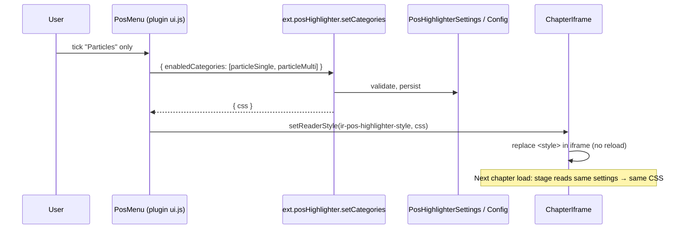

# Specification 10: Reader Menu Bar POS Category Selector

## Status: Approved for implementation
**Extends:** [09 — Part-of-Speech Highlighter Plugin](09-part-of-speech-highlighter-plugin-spec.md)
**Scope:** `PosHighlighter` plugin (settings, CSS generation, RPC), plugin SDK (toolbar popover, reader style injection), `ReaderTopBar` plugin slot, tests, wiki.
**Plan:** [10-pos-highlight-category-menu-implementation-plan.md](10-pos-highlight-category-menu-implementation-plan.md) · **Feature file:** [features/08-pos-highlight-category-menu.feature](features/08-pos-highlight-category-menu.feature)

---

## 1. Why

Today the POS highlighter colors all 13 grammatical categories at once. For a learner this is noisy: someone studying particles wants *only* particles lit, someone drilling verb groups wants only verbs. Changing this currently means going to Settings → Installed Plugins and editing colors, which has no "off" per category and is far from the text being read.

Spec 09 §1 already promised "a UI extension (`ui.js`) that mounts a toggle button in the reader top bar". That button exists but **does not work** (see §2.1), so this spec also repairs it.

## 2. Current state (verified in code)

| Fact | Where |
| :--- | :--- |
| 13 categories are each assigned a CSS rule from `Settings.Color*`; there is no per-category enable flag | `PosDomEnrichmentStage.GenerateCss` |
| Token classes/`data-ir-pos` are always written to the DOM when the plugin is enabled; only the injected `<style id="ir-pos-highlighter-style">` decides what is visible | `PosDomEnrichmentStage.Enrich` / `InjectStyles` |
| Chapters are **re-enriched on every load** (the cache stores only the token map, not HTML), so a changed stage setting applies on the next chapter load with no cache invalidation | `BookSchemeHandler.GetEnrichedChapter`, `ChapterEnrichmentCache` |
| Chapter HTML is shown in an iframe whose document the host can reach (`iframe.contentDocument`) | `ChapterIframe.tsx` |
| Plugin UI is an ESM bundle that imports `@ir/sdk` (`usePluginRpc`, `usePluginConfig`, …) | `sdk/index.tsx`, `index.html` import map |

### 2.1 Defect: the existing toolbar button is inert
`Assets/ui.js` destructures `{ rpc, toast }` from the `onClick` argument, but `ReaderToolbarPluginSlot` only passes `{ openModal, toggleDrawer, navigateToView, getPluginConfig }`. `rpc` is `undefined`, so the call throws, is caught, and logged to the console. Nothing happens for the user, and even if the RPC ran, the open chapter would not refresh.

## 3. Requirements

### Functional
- **FR-1** A "Highlights" button appears in the reader top bar (inside the plugin toolbar slot) whenever the `posHighlighter` plugin is enabled, and disappears when it is disabled.
- **FR-2** Clicking it opens a popover anchored under the button listing all 13 categories, each with a color swatch, English name, Japanese label and one example, and a checkbox.
- **FR-3** The popover has a master on/off switch (maps to existing `enabled`), "All", "None", and quick presets: *Verbs*, *Adjectives*, *Particles*, *Grammar words* (particles + auxiliaries + suffixes + conjunctions).
- **FR-4** Changes apply **live** to the open chapter (no reload, scroll position preserved).
- **FR-5** The selection **persists** across restarts and applies to every chapter opened afterwards, and is also reflected in Settings → Installed Plugins.
- **FR-6** Default is all categories enabled, so existing users see no change. Missing/`null` `enabledCategories` means "all".
- **FR-7** Closes on Escape, outside click, or re-clicking the button.

### Non-functional
- **NFR-1** Offline and deterministic (project invariants); no new dependencies.
- **NFR-2** CSS generation lives in **one place** (C# `GenerateCss`); the client never re-implements category selectors.
- **NFR-3** Unknown category ids from a client are ignored, not stored.
- **NFR-4** Plugin hot-disable removes the button and any live style override.
- **NFR-5** Fix the inert button; no regression to the Settings schema form.

## 4. Design

### 4.1 Category catalog (single source of truth, C#)
New `PosCategory` catalog in the plugin: `id`, `label` (English), `jpLabel`, `example`, `ColorOf(settings)`, `selectors`. Ids:

`adjI, adjNa, verbGodan, verbIchidan, verbIrregular, suffix, particleSingle, particleMulti, adverb, noun, conjunction, auxiliary, interjection`

`GenerateCss` is rewritten to iterate the catalog and skip categories not in `EnabledCategories`. The selector strings are moved verbatim from the current `AppendRule` calls (no behavior change when all are enabled; guarded by a snapshot-style test).

### 4.2 Settings
`PosHighlighterSettings.EnabledCategories : List<string>?` → JSON `enabledCategories`. `null` = all. Helper `IsEnabled(id)`. Added to `settings.defaults.json` as the full list and to `settings.schema.json` as an `array` of strings. **The settings form only supports scalar types** (`JsonSchemaProperty.type` is `string|number|integer|boolean`), so the property is marked `"x-hidden": true` and the form skips it (small change in the schema form renderer) rather than rendering garbage.

### 4.3 RPC (extends spec 09 §4.3)
| Action | Payload | Result |
| :--- | :--- | :--- |
| `ext.posHighlighter.getCategories` | `{}` | `{ enabled, highlightStyle, categories: [{id,label,jpLabel,example,color,enabled}] }` |
| `ext.posHighlighter.setCategories` | `{ enabledCategories: string[] }` and/or `{ enabled: bool }` | `{ success, enabled, enabledCategories, css }` |
| `ext.posHighlighter.getCss` | `{}` | `{ css }` (empty string when plugin disabled) |

`setCategories` validates ids against the catalog (NFR-3), updates `Settings`, persists through `context.Config.UpdateAsync`, and returns the freshly generated CSS so the client can apply it without a second round trip. Existing `toggle` / `updateSettings` keep working.

### 4.4 SDK / host changes (generic, reusable by other plugins)
1. `PluginToolbarActionRegistration` gains optional `popover?: ComponentType<{ onClose: () => void }>`. When present, the host renders the button as a popover trigger and mounts that component in an anchored panel instead of calling `onClick`. `onClick` becomes optional.
2. `ToolbarActionContext` gains `rpc(actionName, payload)` already scoped to the plugin (`ext.<pluginId>.<action>`) so simple actions like the old toggle work. This repairs defect 2.1 for any plugin.
3. New SDK export `setReaderStyle(styleId: string, css: string | null)`. It writes to a new `injectedStyles` map in `useReaderStore`; `ChapterIframe` applies every entry into `<style id="{styleId}">` in the iframe document, on change **and after each iframe load**. `null` removes the style.

   For the highlighter, `styleId = "ir-pos-highlighter-style"`, the same id the server injects, so the live CSS *replaces* the server one rather than stacking.
4. Cleanup: `unloadPluginUiRegistrations` also drops that plugin's injected styles (NFR-4). Style ids are namespaced per plugin in the store key.

### 4.5 Plugin UI (`Assets/ui.js`)
Registers one toolbar action `{ id: 'pos-highlighter-menu', label: 'Highlights', icon: Palette, popover: PosMenu }`.
`PosMenu` (uses `usePluginRpc`, no JSX, plain `React.createElement` since this file is not bundled):
- On mount: `getCategories`.
- On any change: optimistic state update → `setCategories` → `setReaderStyle('ir-pos-highlighter-style', css)`.
- Requests are serialized (latest wins) so rapid clicks cannot apply out of order.
- Error → inline message, state rolled back.

### 4.6 Data flow

## 5. Edge cases
- Plugin enabled but `enabled=false` (master off): `getCss` returns `""`; popover shows the master switch off and category checkboxes disabled.
- All categories unticked: valid; CSS is just the base `rt` guard rule.
- Iframe not loaded yet when a style is set: applied on iframe load via the store (FR-4).
- Config changed from Settings tab while popover is open: popover re-reads on `extensions.configChanged` for `posHighlighter`.
- Old config without `enabledCategories`: treated as all (FR-6).

## 6. Test plan
**C# (`PosHighlighterTests.cs`)**
- `GenerateCss_AllCategoriesEnabled_MatchesPreviousOutput` (regression guard for the refactor).
- `GenerateCss_OnlyParticles_ContainsParticleRulesAndNoVerbRules`.
- `GenerateCss_NoCategories_OnlyRubyGuardRule`.
- `Settings_NullEnabledCategories_MeansAll` and JSON round trip.
- `Rpc_SetCategories_IgnoresUnknownIds_PersistsAndReturnsCss`.
- `Rpc_GetCategories_ReturnsAll13WithEnabledFlags`.
- `Stage_Enrich_InjectsStyleReflectingEnabledCategories`.

**Contract:** `RpcContractTests`/`UnifiedPluginSystemTests` still pass.

**Client:** `npm run build` (tsc type check) and `npm run lint` pass. Manual: `--verify-ui`, then the scenarios in the feature file.

## 7. As built (deviations from the design above)
- The catalog is `PosCategoryCatalog` / `PosCategoryInfo`, keyed on the **existing** `PosCategory` enum (a class named `PosCategory` would have collided). Ids are the camelCase names listed in §4.1.
- `setReaderStyle(pluginId, styleId, css)` takes the plugin id explicitly (the SDK function has no plugin context). Passing `null` forgets the override but does not remove the DOM `<style>`; the highlighter always passes a string (`""` when switched off).
- Two hand-maintained import shims in `AppSchemeHandler.GetSdkShim` also had to be extended (`Palette`, `setReaderStyle`); a guard test now enforces this.
- **Not implemented:** the popover does not re-read when Settings changes the config while it is open (§5). It re-reads each time it is opened, so the practical impact is small.
- **Plugin UI loading was broken** (page origin `file://`, `ir-app://` fetches blocked); fixed by [spec 11](11-plugin-ui-loading-spec.md). With it, the Highlights scenario now passes end to end in the real window (`--verify-ui` field `posMenu=ok(...)`).
- **Not verified by an automated end-to-end run:** the Photino WebView cannot be driven here. Backend RPC/CSS behavior is covered by tests; the client passes `tsc -b` and `vite build`. The scenarios in the feature file still need a manual pass in the running app.

## 8. Out of scope
Per-category custom colors in the popover (stay in Settings), per-book selections, highlight styles switcher in the popover, keyboard shortcut. Candidates for a follow-up.
