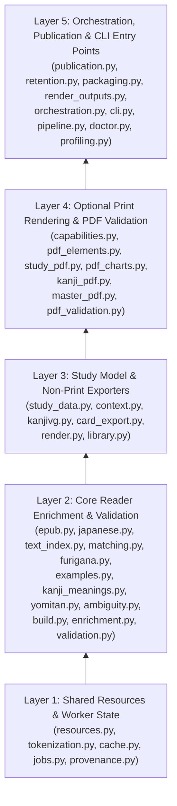

# Architecture & Dataflow

This page explains how [`enrichement-extractor`](../enrichement-extractor) is structured, how its three execution modes (`reader`, `study`, `decks`) operate, and how dependencies are isolated between core reader enrichment and supplementary study exports.

---

## 1. Layered Architecture

The codebase is organized into five strict layers where lower layers never import higher layers:

### Base vs. `[print]` Dependency Boundary
Defined in [`pyproject.toml`](../enrichement-extractor/pyproject.toml#L6-L13):
- **Base dependencies** (always installed): `beautifulsoup4`, `lxml`, `sudachipy`, `sudachidict_core`, `jsonschema`, `packaging`.
  - Sufficient for: `reader` enrichment, `decks` updates, `html` study generation, `cards` flashcard JSON export, `study-pack.zip` packaging, caching, retention, and Layer 1 + Layer 2 verification.
- **Optional `[print]` dependencies**: `reportlab`, `pymupdf`, `fonttools`, `pillow`.
  - Required **only** when `pdf=True` during `render_book()`, `verify_pdfs()`, or `doctor.check()`.
  - Checked lazily via [`require_print()`](../enrichement-extractor/immersive/capabilities.py#L5-L8).

---

## 2. Execution Modes & CLI Entry Points

Both CLI entry points ([`immersive.cli:main`](../enrichement-extractor/immersive/cli.py#L11-L60) and [`immersive.pipeline:main`](../enrichement-extractor/immersive/pipeline.py#L44-L85)) construct a [`BuildOptions`](../enrichement-extractor/immersive/orchestration.py#L16-L33) instance and delegate to [`run_job()`](../enrichement-extractor/immersive/orchestration.py#L93-L108).

| Mode (`BuildOptions.mode`) | Triggered By | What It Does | Modifies Source CSVs? | Publishes to `output/`? |
| :--- | :--- | :--- | :--- | :--- |
| **`reader`** | `immersive.cli enrich` `immersive.pipeline --reader-only` `BuildOptions(mode="reader")` | Enriches EPUB + CSV/Yomitan, validates against `reader.schema.json`, stages and publishes `reader.json`, `lookup.json`, `quality.json`. Retains any prior `study` snapshot for that book. | **Never** (`--update-decks` is rejected) | Yes (`reader` snapshot + flat `data/<book-id>/` views) |
| **`study`** | `immersive.cli build` `immersive.pipeline` (default) `BuildOptions(mode="study", ...)` | Performs `reader` enrichment, plus optional `html`, `pdf`, `cards`, verification (`verify()`), and `package` (`study-pack.zip`). | Only if `--update-decks` is passed | Yes (`reader` + `study` snapshots, `shared` artifacts, and flat views) |
| **`decks`** | `immersive.cli decks` `immersive.pipeline --decks-only` `BuildOptions(mode="decks")` | Enriches & validates all selected books, verifies resource hashes, then writes 1-based `first_appearance` character offsets into source CSVs and updates `.enrichment/deck-provenance.json`. | **Yes** (atomic write with write-ahead provenance) | **No** |

### CLI Comparison: `immersive.cli` vs `immersive.pipeline`
- **`python -m immersive.cli {build,enrich,decks}`** ([`cli.py`](../enrichement-extractor/immersive/cli.py)):
  - Designed for machine/subprocess integration as well as developer use.
  - Prints one compact JSON summary line per book to `stdout` (`book_id`, `book`, `output`, counts, `diagnostics`, `export_status`, `cache_status`, `reader_generation`, `study_directory`) and JSON errors/warnings to `stderr`.
  - In `build` mode, builds HTML + PDF by default; `--cards` and `--package` are opt-in flags.
- **`python -m immersive.pipeline`** ([`pipeline.py`](../enrichement-extractor/immersive/pipeline.py)):
  - Full-study preset used by `Run.cmd` in the portable distribution.
  - Builds HTML + PDF + cards + verification + `study-pack.zip` by default (`--skip-html`, `--skip-pdf`, `--skip-cards`, `--skip-package`, `--skip-verify` opt out).
  - Supports `--doctor` to invoke [`doctor.check()`](../enrichement-extractor/immersive/doctor.py#L13-L56).
  - Prints human-readable progress lines via `_console_event()`.

---

## 3. Step-by-Step Dataflow Inside `run_job()`

When [`run_job()`](../enrichement-extractor/immersive/orchestration.py#L93-L258) executes in [`immersive/orchestration.py`](../enrichement-extractor/immersive/orchestration.py):

1. **Worker & Store Acquisition** ([`orchestration.py#L105-L113`](../enrichement-extractor/immersive/orchestration.py#L105-L113)):
   - Enters [`resource_worker()`](../enrichement-extractor/immersive/resources.py#L353-L386), which pins reader resources (`kanjidic2.xml.gz`, `kanji-alive/ka_data.csv`, `kanji-alive/source.json`, `grammar.json`, Sudachi `system.dic` + user dicts, and Yomitan ZIPs) via [`store.reader_manifest()`](../enrichement-extractor/immersive/resources.py#L280-L284).
2. **Book Discovery** ([`orchestration.py#L118-L121`](../enrichement-extractor/immersive/orchestration.py#L118-L121)):
   - Resolves either `--book <folder>` or all immediate subdirectories of `--books` containing `*.epub`.
3. **Reader Enrichment & Caching** ([`orchestration.py#L127-L144`](../enrichement-extractor/immersive/orchestration.py#L127-L144)):
   - Calls [`enrich_book()`](../enrichement-extractor/immersive/enrichment.py#L22-L70) for each folder:
     - Computes semantic cache key via [`reader_inputs()`](../enrichement-extractor/immersive/cache.py#L142-L177) (excludes derived `first_appearance` CSV column so deck updates don't invalidate cache).
     - On **cache hit**: hydrates current file SHA-256s and raw CSV row fields via [`hydrate_reader()`](../enrichement-extractor/immersive/cache.py#L180-L186).
     - On **cache miss**: runs [`build_data()`](../enrichement-extractor/immersive/build.py#L79-L351), validates with [`validate_reader()`](../enrichement-extractor/immersive/validation.py#L82-L202), and writes `.json.gz` to [`ContentCache`](../enrichement-extractor/immersive/cache.py#L42-L140).
   - Rejects duplicate EPUB Book IDs across input folders.
4. **Explicit Deck Updates (if requested)** ([`orchestration.py#L146-L155`](../enrichement-extractor/immersive/orchestration.py#L146-L155)):
   - Re-verifies all reader resource hashes *before* touching any source CSV.
   - Calls [`enrich_decks(book, folder)`](../enrichement-extractor/immersive/deck_enrichment.py#L11-L15) under `.enrichment/deck-update.lock`.
   - If `mode == "decks"`, returns `JobResult` immediately.
5. **Input Stamp Recording** ([`orchestration.py#L156-L175`](../enrichement-extractor/immersive/orchestration.py#L156-L175)):
   - Records SHA-256 and byte size of every EPUB, CSV, `study.config.json`, `.enrichment/deck-provenance.json`, and Yomitan ZIP in `_source_stamps()`. Defines `unchanged_inputs()` precommit hook.
6. **Private Staging & Study Exports** ([`orchestration.py#L177-L221`](../enrichement-extractor/immersive/orchestration.py#L177-L221)):
   - Enters `with Publication(output, base=base, cancel=cancel) as publication:`.
   - Creates `.publication/staging/<generation>/` with OS lease lock `.lease.lock`.
   - Writes core reader JSON (`reader.json`, `quality.json`, `lookup.json`) into staging `books/<bid>/reader/data/<bid>/` and registers the `reader` snapshot.
   - In `study` mode:
     - Adds KanjiVG stroke order via [`add_stroke_order()`](../enrichement-extractor/immersive/kanjivg.py#L19-L42) (if HTML or PDF enabled).
     - Prepares [`StudyData`](../enrichement-extractor/immersive/study_data.py#L35-L48) via [`prepare_study_data()`](../enrichement-extractor/immersive/study_data.py#L51-L77).
     - Renders HTML and/or PDF into staging `books/<bid>/study/` via [`render_book()`](../enrichement-extractor/immersive/render_outputs.py#L8-L18).
     - Verifies staged outputs via [`verify()`](../enrichement-extractor/immersive/verification.py#L81-L86).
     - **Partial failure isolation**: If document rendering or verification raises a non-cancellation exception, `publication.discard_study(bid)` removes the broken study staging tree for that book, records the failure in `result.export_error`, and **still publishes the valid `reader` snapshot** while retaining the book's previous `study` snapshot!
7. **Atomic Commit & View Refresh** ([`orchestration.py#L222-L247`](../enrichement-extractor/immersive/orchestration.py#L222-L247)):
   - [`publication.publish()`](../enrichement-extractor/immersive/publication.py#L539-L646) acquires `.publication/publish.lock`, checks for concurrent job conflicts, exports shared flashcards (`library.json`) and `study-pack.zip`, writes `manifest.json` and `seal.json`, runs `precommit=unchanged_inputs`, renames `.publication/staging/<gen>` to `.publication/releases/<gen>`, atomically updates `.publication/active.json`, and refreshes flat compatibility views in `output/`.

