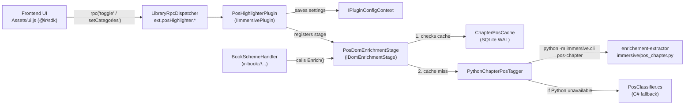

# Creating a New Plugin Tutorial (Based on `PosHighlighter`)

This tutorial walks you through how plugins work in **Immersive Reading** and how to build one from scratch, using the built-in **[Part-of-Speech Highlighter plugin (`ImmersiveReading.Plugins.PosHighlighter`)](../immersive-reader/src/Plugins/ImmersiveReading.Plugins.PosHighlighter)** as a real, working blueprint.

It is written for readers with a **basic understanding of C# or Python**. Every time an intermediate framework concept appears (such as Dependency Injection, `IDisposable`, JSON Schema, or React ES Modules), this guide explains *why* it is needed in plain terms and links to official documentation (Microsoft Learn, Python Docs, MDN, React, AngleSharp, and JSON Schema) if you want to dig deeper.

> **Using AI UI slots only?** Once you understand how the C# plugin connects to `Assets/ui.js`, read [`wiki/plugin-ui-authoring.md`](plugin-ui-authoring.md) for the full catalog of toolbar, drawer, modal, and Book Info tab slots.

---

## 1. The Big Picture: What Can a Plugin Do?

In Immersive Reading, plugins follow strict **separation of concerns**: the desktop application (`ImmersiveReading.App`) never hardcodes feature-plugin logic inside core reader code. Instead, a plugin registers capabilities with the host through [`IPluginHostContext`](../immersive-reader/src/ImmersiveReading.Core/Plugins/IPluginHostContext.cs) when the app turns it on:

| Capability | Host API (`IPluginHostContext`) | What `PosHighlighter` Uses It For |
| :--- | :--- | :--- |
| **RPC Endpoints** | `RegisterRpcAction(name, handler)` | Exposes `ext.posHighlighter.*` actions (`toggle`, `getSettings`, `setCategories`, `clearCache`, etc.) to the React UI. |
| **Reader HTML Modification** | `RegisterDomEnrichmentStage(stage)` | Registers [`PosDomEnrichmentStage`](../immersive-reader/src/Plugins/ImmersiveReading.Plugins.PosHighlighter/PosDomEnrichmentStage.cs) (`IDomEnrichmentStage`) to inject `<style>` rules and tag words with `data-word-type` / `data-sub-type`. |
| **Settings Persistence & Auto-UI** | `Config` (`settings.schema.json` + `settings.defaults.json`) | Stores user colors, style mode, cache limit, and active categories in `library.db` and auto-generates the Settings tab. |
| **Frontend UI** | `PluginManifest.UiEntry = "ui.js"` | Loads [`Assets/ui.js`](../immersive-reader/src/Plugins/ImmersiveReading.Plugins.PosHighlighter/Assets/ui.js) to add a palette popover button in the reader toolbar. |
| **Optional Python NLP** | `ProcessStartInfo` (`cli pos-chapter`) **or** `RegisterPythonStage(...)` | Calls [`immersive.pos_chapter`](../enrichement-extractor/immersive/pos_chapter.py) via JSON `stdin`/`stdout`, with an in-process C# fallback ([`PosClassifier.cs`](../immersive-reader/src/Plugins/ImmersiveReading.Plugins.PosHighlighter/PosClassifier.cs)) and SQLite cache ([`ChapterPosCache.cs`](../immersive-reader/src/Plugins/ImmersiveReading.Plugins.PosHighlighter/ChapterPosCache.cs)). |

*(Other plugins also use `Database` for plugin-local SQLite migrations, `RegisterLanguageAnalyzer` for tokenizers, and `RegisterKnowledgeSource` for [`KnowledgeHub`](../immersive-reader/src/ImmersiveReading.Knowledge/KnowledgeHub.cs).)*

### How `PosHighlighter` Fits Together



### Prerequisites
- **.NET 10 SDK** (for building/testing `immersive-reader/ImmersiveReading.sln`)
- **Python 3.12+** inside `enrichement-extractor/.venv` (if your plugin calls Python)
- **Node.js 20+** (only needed if you write your UI in `.jsx` instead of plain `.js`)

---

## 2. Official Documentation Quick Reference

Bookmark this table—it maps every framework concept used below to the official documentation:

| Concept in This Guide | Official Resource | Why You Might Read It |
| :--- | :--- | :--- |
| **C# classes, interfaces, `record`, `async`/`await`** | [Microsoft Learn — C# Guide](https://learn.microsoft.com/en-us/dotnet/csharp/) | Basics and modern C# syntax (`record`, pattern matching, `ValueTask`). |
| **.NET Dependency Injection** | [Microsoft Learn — Dependency Injection in .NET](https://learn.microsoft.com/en-us/dotnet/core/extensions/dependency-injection) | How `IServiceCollection` and `AddSingleton` create and share services automatically. |
| **Resource Cleanup (`IDisposable` / `IAsyncDisposable`)** | [Implementing Dispose](https://learn.microsoft.com/en-us/dotnet/standard/garbage-collection/implementing-dispose) & [DisposeAsync](https://learn.microsoft.com/en-us/dotnet/standard/garbage-collection/implementing-disposeasync) | Explains the **must-know DI trap** when a plugin implements `IAsyncDisposable`. |
| **JSON in C# (`System.Text.Json`)** | [Microsoft Learn — System.Text.Json Overview](https://learn.microsoft.com/en-us/dotnet/standard/serialization/system-text-json/overview) | Reading `JsonElement` settings and using `[JsonPropertyName]`. |
| **Embedded Files in `.csproj`** | [Microsoft Learn — Resources in .NET](https://learn.microsoft.com/en-us/dotnet/core/extensions/resources) | Why `settings.schema.json` and `Assets/ui.js` work without copying loose files manually. |
| **Running Python from C# (`ProcessStartInfo`)** | [Microsoft Learn — ProcessStartInfo](https://learn.microsoft.com/en-us/dotnet/api/system.diagnostics.processstartinfo) | Launching `python` with UTF-8 `stdin`/`stdout` redirection safely. |
| **SQLite in C#** | [Microsoft Learn — Microsoft.Data.Sqlite](https://learn.microsoft.com/en-us/dotnet/standard/data/sqlite/) | Querying and caching chapter results cleanly on disk. |
| **Modifying HTML in C# (AngleSharp)** | [AngleSharp Documentation](https://anglesharp.github.io/) | Querying elements (`QuerySelectorAll`), creating `<style>`, and setting attributes on `IDocument`. |
| **JSON Schema** | [Understanding JSON Schema](https://json-schema.org/understanding-json-schema) | How `settings.schema.json` describes checkboxes, dropdowns, numbers, and color pickers. |
| **Python CLI & JSON** | [Python `argparse`](https://docs.python.org/3/library/argparse.html), [`json`](https://docs.python.org/3/library/json.html), [`unittest`](https://docs.python.org/3/library/unittest.html) | Writing clean JSON-over-stdio Python helpers and unit tests. |
| **Browser ES Modules & React** | [MDN — JavaScript Modules](https://developer.mozilla.org/en-US/docs/Web/JavaScript/Guide/Modules) & [React Learn](https://react.dev/learn) | Writing `Assets/ui.js` with `React.createElement` (no build step) or JSX. |

---

## 3. Step 1 — Create the Plugin Project & Embed Resources

Every first-party plugin lives in its own folder under `immersive-reader/src/Plugins/`. For example, `PosHighlighter` lives at [`src/Plugins/ImmersiveReading.Plugins.PosHighlighter/`](../immersive-reader/src/Plugins/ImmersiveReading.Plugins.PosHighlighter):

```text
ImmersiveReading.Plugins.MyPlugin/
├── ImmersiveReading.Plugins.MyPlugin.csproj
├── MyPlugin.cs                  # Entry point (IImmersivePlugin + IDisposable)
├── MyPluginModule.cs            # DI registration (IPluginModule)
├── MyPluginSettings.cs          # Strongly typed settings wrapper
├── settings.defaults.json       # Default JSON values (EmbeddedResource)
├── settings.schema.json         # JSON Schema driving the Settings UI (EmbeddedResource)
└── Assets/
    └── ui.js                    # Frontend ES module loaded in the app (EmbeddedResource)
```

Create your `.csproj` modeled on [`ImmersiveReading.Plugins.PosHighlighter.csproj`](../immersive-reader/src/Plugins/ImmersiveReading.Plugins.PosHighlighter/ImmersiveReading.Plugins.PosHighlighter.csproj):

```xml
<Project Sdk="Microsoft.NET.Sdk">
  <PropertyGroup>
    <TargetFramework>net10.0</TargetFramework>
    <ImplicitUsings>enable</ImplicitUsings>
    <Nullable>enable</Nullable>
  </PropertyGroup>

  <ItemGroup>
    <!-- Required: zero-dependency plugin contracts -->
    <ProjectReference Include="..\..\ImmersiveReading.Core\ImmersiveReading.Core.csproj" />
    <!-- Optional: add ONLY if your plugin registers an IDomEnrichmentStage for reader XHTML -->
    <ProjectReference Include="..\..\ImmersiveReading.Enrichment\ImmersiveReading.Enrichment.csproj" />
  </ItemGroup>

  <!-- Crucial: embed schemas, defaults, and Assets so PluginHostManager can load them from your DLL -->
  <ItemGroup>
    <EmbeddedResource Include="settings.defaults.json" />
    <EmbeddedResource Include="settings.schema.json" />
    <EmbeddedResource Include="Assets\**\*" />
  </ItemGroup>
</Project>
```

### Why `<EmbeddedResource>`?
Instead of copying loose JSON and JS files around at build time, `<EmbeddedResource>` bundles `settings.defaults.json`, `settings.schema.json`, and `Assets/*` right inside your compiled `.dll`. At runtime, the plugin host serves `ui.js` directly from your assembly (via `ir-app://plugins/<pluginId>/ui.js`).  
*Learn more: [Microsoft Learn — Embedded Resources](https://learn.microsoft.com/en-us/dotnet/core/extensions/resources).*

---

## 4. Step 2 — Define Settings (`settings.defaults.json` & `settings.schema.json`)

The app handles settings persistence automatically in `library.db` through [`IPluginConfigContext`](../immersive-reader/src/ImmersiveReading.Core/Plugins/IPluginConfigContext.cs). You only declare two JSON files and a small C# settings class.

### 1. Default values (`settings.defaults.json`)
Give every setting a sensible starting value, just like [`PosHighlighter/settings.defaults.json`](../immersive-reader/src/Plugins/ImmersiveReading.Plugins.PosHighlighter/settings.defaults.json):

```json
{
  "enabled": true,
  "highlightStyle": "text-color",
  "colorNoun": "#93c5fd",
  "maxCacheSizeMb": 500,
  "usePythonNlp": true,
  "pythonPath": "",
  "enabledCategories": ["adj_i", "adj_na", "verb_godan", "verb_ichidan", "noun"]
}
```

### 2. Schema & Auto-Generated Settings UI (`settings.schema.json`)
The app reads [`settings.schema.json`](../immersive-reader/src/Plugins/ImmersiveReading.Plugins.PosHighlighter/settings.schema.json) to render controls in **Settings -> Plugins** automatically:

- `"type": "boolean"` renders a toggle switch.
- `"type": "string"` + `"enum": [...]` renders a dropdown.
- `"type": "string"` + `"format": "color"` renders a color picker.
- `"type": "integer"` + `"minimum"` / `"maximum"` renders a numeric field.
- **`"x-hidden": true`** tells the generic Settings tab **not** to draw a raw control for that property—useful when your custom toolbar popover manages it (in `PosHighlighter`, `enabledCategories` has `"x-hidden": true` because the palette popover toggles categories interactively).

*Learn more: [Understanding JSON Schema](https://json-schema.org/understanding-json-schema).*

### 3. Strongly Typed C# Wrapper (`MyPluginSettings.cs`)
Using `System.Text.Json` attributes like `[JsonPropertyName("maxCacheSizeMb")]`, [`PosHighlighterSettings.cs`](../immersive-reader/src/Plugins/ImmersiveReading.Plugins.PosHighlighter/PosHighlighterSettings.cs) converts the raw `JsonElement` returned by `context.Config.GetRawJson()` into clean C# properties via a helper method `FromJson(JsonElement element)` (returning defaults if deserialization yields `null`).  
*Learn more: [Microsoft Learn — System.Text.Json](https://learn.microsoft.com/en-us/dotnet/standard/serialization/system-text-json/overview).*

---

## 5. Step 3 — Implement the Plugin Entry Point (`IImmersivePlugin`)

Every unified plugin implements [`IImmersivePlugin`](../immersive-reader/src/ImmersiveReading.Core/Plugins/IImmersivePlugin.cs), which defines:
- `PluginManifest Manifest { get; }` (see [`PluginLifecycle.cs`](../immersive-reader/src/ImmersiveReading.Core/Plugins/PluginLifecycle.cs))
- `ValueTask OnEnableAsync(IPluginHostContext context, CancellationToken ct = default)`
- `ValueTask OnDisableAsync(CancellationToken ct = default)`
- `ValueTask DisposeAsync()` (inherited from `IAsyncDisposable`)

Here is a minimal plugin skeleton modeled directly on [`PosHighlighterPlugin.cs`](../immersive-reader/src/Plugins/ImmersiveReading.Plugins.PosHighlighter/PosHighlighterPlugin.cs):

```csharp
using System.Text.Json;
using ImmersiveReading.Core.Extensions;
using ImmersiveReading.Core.Plugins;

namespace ImmersiveReading.Plugins.MyPlugin;

// IMPORTANT: Implement BOTH IImmersivePlugin (IAsyncDisposable) AND IDisposable
// whenever your plugin is registered as a Singleton in Microsoft DI!
public sealed class MyPlugin : IImmersivePlugin, IDisposable
{
    public const string PluginIdValue = "myPlugin";

    public PluginManifest Manifest { get; } = new()
    {
        Id = PluginIdValue,
        Name = "My Highlighter Plugin",
        Version = "1.0.0",
        Author = "Your Name",
        Description = "Highlights matching tokens inside reader chapters.",
        ReloadBehavior = PluginReloadBehavior.Hot, // Enable/disable without app restart
        UiEntry = "ui.js"                          // Matches Assets/ui.js
    };

    private IPluginHostContext? _context;
    private MyDomEnrichmentStage? _stage;

    public ValueTask OnEnableAsync(IPluginHostContext context, CancellationToken ct = default)
    {
        _context = context;
        var settings = MyPluginSettings.FromJson(context.Config.GetRawJson());

        // 1. Register reader DOM stage (if your plugin modifies book XHTML)
        _stage = new MyDomEnrichmentStage { Settings = settings };
        context.RegisterDomEnrichmentStage(_stage);

        // 2. Register RPC actions exposed to the UI as "ext.myPlugin.<actionName>"
        context.RegisterRpcAction("getSettings", (payload, token) =>
        {
            return Task.FromResult<object?>(_stage.Settings);
        });

        context.RegisterRpcAction("toggle", async (payload, token) =>
        {
            var nextEnabled = payload.TryGetProperty("enabled", out var prop)
                ? prop.GetBoolean()
                : !_stage.Settings.Enabled;

            var patch = JsonSerializer.SerializeToElement(new { enabled = nextEnabled });
            await context.Config.UpdateAsync(patch, token);
            _stage.Settings = MyPluginSettings.FromJson(context.Config.GetRawJson());
            return new { enabled = _stage.Settings.Enabled };
        });

        return ValueTask.CompletedTask;
    }

    public ValueTask OnDisableAsync(CancellationToken ct = default)
    {
        _context = null;
        return ValueTask.CompletedTask;
    }

    // Synchronous cleanup for ServiceProvider.Dispose()
    public void Dispose() { }

    // Asynchronous cleanup for IImmersivePlugin
    public ValueTask DisposeAsync()
    {
        Dispose();
        return ValueTask.CompletedTask;
    }
}
```

### ⚠️ Crucial Beginner Trap: Always Implement `IDisposable` Alongside `IAsyncDisposable`
`IImmersivePlugin` inherits from `IAsyncDisposable`. In [`AppServices.cs`](../immersive-reader/src/ImmersiveReading.App/Composition/AppServices.cs), the desktop app's shutdown disposes its dependency-injection `ServiceProvider` synchronously. If your plugin class is registered via `services.AddSingleton<MyPlugin>()` and **only** implements `IAsyncDisposable`, the app will throw an `InvalidOperationException` at shutdown (`'...MyPlugin' type only implements IAsyncDisposable`). Adding `public void Dispose()` next to `DisposeAsync()` avoids this completely!  
*Learn more: [Microsoft Learn — Implementing Dispose](https://learn.microsoft.com/en-us/dotnet/standard/garbage-collection/implementing-dispose) & [Implementing DisposeAsync](https://learn.microsoft.com/en-us/dotnet/standard/garbage-collection/implementing-disposeasync).*

---

## 6. Step 4 — Modify Chapter HTML in the Reader (`IDomEnrichmentStage`)

When a user opens a chapter, [`BookSchemeHandler`](../immersive-reader/src/ImmersiveReading.Enrichment/BookSchemeHandler.cs) runs [`AngleSharpDomEnricher`](../immersive-reader/src/ImmersiveReading.Enrichment/AngleSharpDomEnricher.cs), which parses the EPUB `.xhtml` file into an AngleSharp `IDocument` DOM tree, tokenizes it with the active language plugin (e.g. `MeCab` for Japanese), and then runs every enabled `IDomEnrichmentStage` in ascending `Order`.

[`PosDomEnrichmentStage.cs`](../immersive-reader/src/Plugins/ImmersiveReading.Plugins.PosHighlighter/PosDomEnrichmentStage.cs) sets:
- `StageId => "pos-highlighter"`
- `Order => 200` (runs after base tokenization has already placed clickable `.ir-tok` token elements in the DOM)

Inside `Enrich(IDocument document, DomEnrichmentContext context)`:
1. It reads `context.BookId`, `context.ChapterHref`, and `context.Tokens` (see [`IReaderServices.cs`](../immersive-reader/src/ImmersiveReading.Core/Extensions/IReaderServices.cs#L6-L18)).
2. It injects a `<style id="ir-pos-highlighter-style">` element built by `PosDomEnrichmentStage.GenerateCss(Settings)` into `document.Head` using CSS variables/attributes like `[data-word-type="verb"]`.
3. It inspects tokens (via cache / Python tagger / C# fallback) and sets attributes (`data-word-type`, `data-sub-type`) or wraps morpheme spans inside the chapter's DOM nodes.

### Why Use `<style>` + `data-*` Attributes Instead of Hardcoded Inline `style="..."`?
Using `data-word-type` attributes plus a single `<style>` block lets the React toolbar popover change colors or turn categories off **instantly** via CSS (`setReaderStyle` in `@ir/sdk`), without having to re-parse or reload the chapter!

*Learn more: [AngleSharp Documentation](https://anglesharp.github.io/) and [MDN — Using `data-*` Attributes](https://developer.mozilla.org/en-US/docs/Learn_web_development/Howto/Solve_HTML_problems/Use_data_attributes).*

---

## 7. Step 5 — Calling Python Safely from C# (Two Supported Patterns)

Depending on when your Python code needs to run, Immersive Reading supports **two clean patterns**.

### Pattern A: On-Demand Chapter Subprocess (`PosHighlighter` Approach)
When opening a chapter in the reader needs fast morphological analysis (SudachiPy in Python), [`PythonChapterPosTagger.cs`](../immersive-reader/src/Plugins/ImmersiveReading.Plugins.PosHighlighter/PythonChapterPosTagger.cs) does the following:

1. **Locate Python cleanly**: Uses `IPythonEnvironmentResolver` ([`PythonEnvironmentResolver.cs`](../immersive-reader/src/ImmersiveReading.Core/Infrastructure/PythonEnvironmentResolver.cs)) rather than hardcoding `"C:\\..."` paths. Users can also override `pythonPath` in plugin settings.
2. **Send JSON over `stdin` / read JSON from `stdout`**: Spawns `<python.exe> -m immersive.cli pos-chapter` via `ProcessStartInfo` with `StandardInputEncoding = Encoding.UTF8` and `StandardOutputEncoding = Encoding.UTF8`. Passing Japanese text over UTF-8 pipes avoids Windows shell quoting bugs and length limits.
   - Python side ([`enrichement-extractor/immersive/cli.py`](../enrichement-extractor/immersive/cli.py) -> [`pos_chapter.py`](../enrichement-extractor/immersive/pos_chapter.py)) reads JSON from `sys.stdin`, tags paragraphs/tokens using SudachiPy, and writes JSON to `sys.stdout`.
3. **Always provide a graceful fallback**: If Python or `.venv` isn't installed yet on the user's machine, `PythonChapterPosTagger` falls back cleanly to [`PosClassifier.cs`](../immersive-reader/src/Plugins/ImmersiveReading.Plugins.PosHighlighter/PosClassifier.cs) (in-process C# classification over `MeCab` tokens).
4. **Cache expensive work on disk**: [`ChapterPosCache.cs`](../immersive-reader/src/Plugins/ImmersiveReading.Plugins.PosHighlighter/ChapterPosCache.cs) stores JSON classifications in a SQLite WAL database keyed by `(book_id, chapter_href, content_hash)` with a 500 MB default LRU limit (`MaxCacheSizeMb`) so a chapter is only analyzed once.

### Pattern B: Offline Study Pack / PDF Pipeline Stage (`Japanese` Plugin Approach)
If your plugin adds an offline extraction or study-PDF step rather than live reader highlighting:
- Register a [`PythonStageDescriptor`](../immersive-reader/src/ImmersiveReading.Core/Plugins/PythonStageContracts.cs) with `context.RegisterPythonStage(...)`.
- Write a Python class subclassing `PipelineStage` from [`enrichement-extractor/immersive/sdk/stage.py`](../enrichement-extractor/immersive/sdk/stage.py) (see [`ja_stages.py`](../immersive-reader/src/Plugins/ImmersiveReading.Plugins.Japanese/python/ja_stages.py) as an example).
- `immersive.pipeline_runner` ([`pipeline_runner.py`](../enrichement-extractor/immersive/pipeline_runner.py)) executes registered stages automatically in `Order` during Study Pack builds.

*Learn more: [Microsoft Learn — `ProcessStartInfo`](https://learn.microsoft.com/en-us/dotnet/api/system.diagnostics.processstartinfo), [Python `json` module](https://docs.python.org/3/library/json.html), and [Microsoft.Data.Sqlite](https://learn.microsoft.com/en-us/dotnet/standard/data/sqlite/).*

---

## 8. Step 6 — Build the Frontend UI (`Assets/ui.js` & `@ir/sdk`)

Because core app code stays clean of plugin logic, your plugin brings its own UI script inside `Assets/ui.js`. At runtime, the React app loads your embedded script as a browser ES Module and maps imports like `'react'`, `'lucide-react'`, and `'@ir/sdk'` to the host's running singletons.

Look at how [`PosHighlighter/Assets/ui.js`](../immersive-reader/src/Plugins/ImmersiveReading.Plugins.PosHighlighter/Assets/ui.js) registers a **Reader Toolbar Popover**:

```js
import React from 'react';
import { Palette } from 'lucide-react';
import { usePluginRpc, setReaderStyle } from '@ir/sdk';

const h = React.createElement;

function MyToolbarPopover() {
  const rpc = usePluginRpc('myPlugin');
  const [enabled, setEnabled] = React.useState(true);

  React.useEffect(() => {
    rpc('getSettings', {}).then((s) => {
      if (s) setEnabled(Boolean(s.enabled));
    });
  }, []);

  async function onToggle() {
    const res = await rpc('toggle', { enabled: !enabled });
    if (res) {
      setEnabled(Boolean(res.enabled));
      // Update live <style> inside the reader iframe immediately without reloading!
      setReaderStyle('ir-my-plugin-style', res.enabled ? '[data-word-type="noun"] { color: #93c5fd; }' : '');
    }
  }

  return h('div', { className: 'p-3 space-y-2' },
    h('button', { type: 'button', onClick: onToggle, className: 'px-3 py-1 rounded bg-sky-600 text-white' },
      enabled ? 'Disable Highlight' : 'Enable Highlight'
    )
  );
}

export function register(ctx) {
  ctx.registerReaderToolbarAction({
    id: 'my-plugin-menu',
    label: 'My Highlight',
    icon: Palette,
    popover: MyToolbarPopover,
  });
}
```

### Plain `.js` vs. `.jsx`
- **Zero-build option (used by `PosHighlighter`)**: Write `Assets/ui.js` directly with `React.createElement` (aliased as `h`). You don't need Node or npm at all!
- **JSX option (used by `JitenMoe`, `AiCompanion`, `DeckBuilder`, `CharacterKnowledge`)**: Write `Assets/ui.src.jsx` using normal JSX syntax, set `UiEntry = "ui.js"`, and compile it whenever you change the UI with:
  ```powershell
  cd k:\immersive-reading\immersive-reader\src\ImmersiveReading.App\client
  npm run build:plugins
  ```
See [`wiki/plugin-ui-authoring.md`](plugin-ui-authoring.md) for all available UI slots (`registerReaderDrawer`, `registerLibraryAction`, `registerBookInfoTab`, etc.).

*Learn more: [MDN — JavaScript Modules](https://developer.mozilla.org/en-US/docs/Web/JavaScript/Guide/Modules) and [React Learn (`useState` / `useEffect`)](https://react.dev/learn).*

---

## 9. Step 7 — Register Your Module with the Desktop App

Create a tiny module class modeled on [`PosHighlighterModule.cs`](../immersive-reader/src/Plugins/ImmersiveReading.Plugins.PosHighlighter/PosHighlighterModule.cs):

```csharp
using ImmersiveReading.Core.Extensions;
using ImmersiveReading.Core.Plugins;
using Microsoft.Extensions.DependencyInjection;

namespace ImmersiveReading.Plugins.MyPlugin;

public sealed class MyPluginModule : IPluginModule
{
    public string ModuleId => MyPlugin.PluginIdValue;

    public void ConfigureServices(IServiceCollection services)
    {
        services.AddSingleton<MyPlugin>();
    }

    public IReadOnlyList<IImmersivePlugin> CreateImmersivePlugins(IServiceProvider provider) =>
        [provider.GetRequiredService<MyPlugin>()];

    public void Dispose() { }
}
```

Then wire your project into **three** host files so the desktop app discovers it automatically:
1. Add `<ProjectReference Include="..\Plugins\ImmersiveReading.Plugins.MyPlugin\ImmersiveReading.Plugins.MyPlugin.csproj" />` to [`ImmersiveReading.App.csproj`](../immersive-reader/src/ImmersiveReading.App/ImmersiveReading.App.csproj).
2. Add your `.csproj` to [`ImmersiveReading.sln`](../immersive-reader/ImmersiveReading.sln) (or run `dotnet sln add ...`).
3. Add `new MyPluginModule()` to the list in [`PluginCatalog.cs`](../immersive-reader/src/ImmersiveReading.App/Composition/PluginCatalog.cs).

Because `AppServices` iterates over `PluginCatalog` polymorphically via `CreateImmersivePlugins(sp)`, your plugin's RPC routes, DOM stage, settings schema, and UI module are automatically picked up without changing core dispatchers or UI components!

---

## 10. Step 8 — Test Your Plugin & Common Troubleshooting

### Writing Automated Tests
Model your C# tests after [`PosHighlighterTests.cs`](../immersive-reader/tests/ImmersiveReading.App.Tests/PosHighlighterTests.cs) (xUnit) and Python helper tests after [`test_pos_chapter.py`](../enrichement-extractor/tests/test_pos_chapter.py) (`unittest`). Always isolate temp directories / SQLite DB paths using `Path.GetTempPath()` and clean them up in `Dispose()`.

Run both suites after your changes:

```powershell
# Run .NET solution tests (Core, Enrichment, Dictionaries, App & Plugin tests)
cd k:\immersive-reading\immersive-reader
dotnet test ImmersiveReading.sln

# Run Python study pipeline tests (if your plugin adds/modifies Python stages or CLI handlers)
cd k:\immersive-reading\enrichement-extractor
.venv\Scripts\python.exe -m unittest discover -s tests -v
```

### Beginner Troubleshooting Checklist

| Symptom | Likely Cause | Fix |
| :--- | :--- | :--- |
| **`InvalidOperationException: '...' type only implements IAsyncDisposable`** at app shutdown | Registered plugin as Singleton in DI without synchronous `IDisposable`. | Add `, IDisposable` and `public void Dispose()` to your `IImmersivePlugin` class. |
| **Settings tab or `ui.js` returns 404 / empty** | Files were added to disk, not embedded in `.csproj`. | Check `<EmbeddedResource Include="Assets\**\*" />`, `settings.defaults.json`, and `settings.schema.json` in your `.csproj`, and verify `Manifest.UiEntry = "ui.js"`. |
| **JSON property comes back `null` or default value** | C# property casing (`Enabled`) vs camelCase JSON (`"enabled"`). | Add `[JsonPropertyName("enabled")]` on properties or configure `JsonSerializerOptions { PropertyNameCaseInsensitive = true }`. |
| **Control appears twice (Settings UI AND custom popover)** | Internal array/object setting was left visible in `settings.schema.json`. | Add `"x-hidden": true` to that property in `settings.schema.json`. |
| **Garbled Japanese characters between C# and Python** | Windows console code page used instead of UTF-8. | Set `StandardInputEncoding = Encoding.UTF8` and `StandardOutputEncoding = Encoding.UTF8` in `ProcessStartInfo` (and `PYTHONUTF8=1` if needed). |
| **Plugin UI fails to mount in dev mode** | Syntax error in `ui.js` or forgot `npm run build:plugins` after editing `.jsx`. | Check browser DevTools console (in Photino/browser), verify imports match `'react'`, `'lucide-react'`, or `'@ir/sdk'`, and re-run `npm run build:plugins` if using `.jsx`. |

---

## Where to Go Next
- [`ImmersiveReading.Plugins.PosHighlighter`](../immersive-reader/src/Plugins/ImmersiveReading.Plugins.PosHighlighter) — Read the full working implementation of every step above.
- [`wiki/plugin-ui-authoring.md`](plugin-ui-authoring.md) — Deep dive into `@ir/sdk`, toolbar popovers, reader drawers, Book Info tabs, and JSX compilation.
- [`wiki/dotnet-architecture.md`](dotnet-architecture.md) — Rules for keeping Core, Enrichment, Dictionaries, Library, and Plugins cleanly separated.

